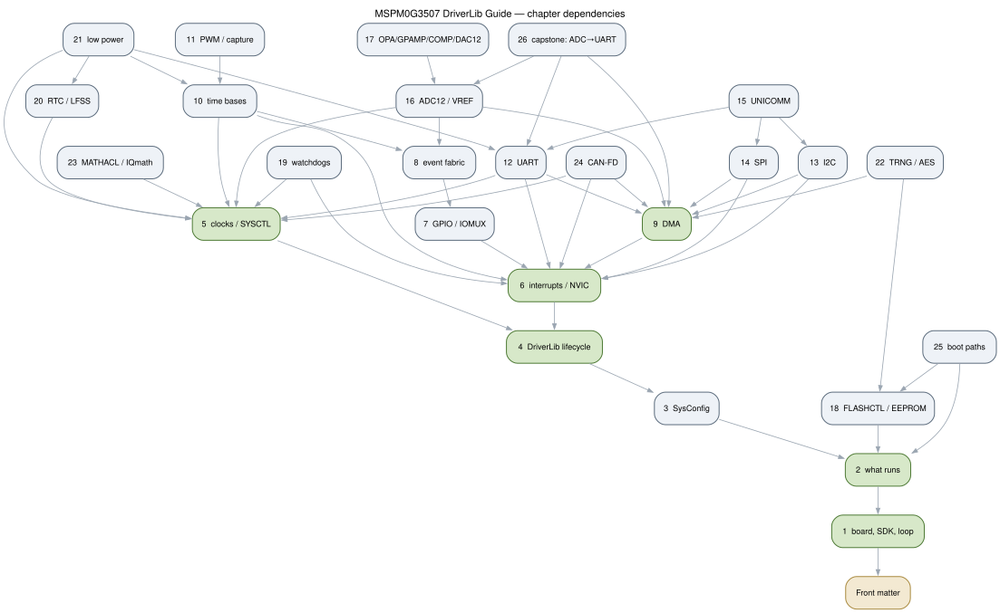
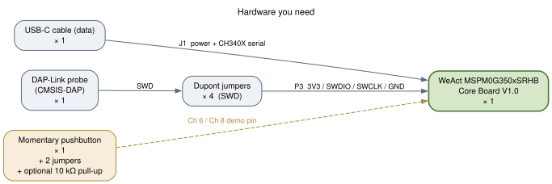

# Front matter

This book teaches the MSPM0G3507 the way you actually meet a new chip: one
board on the desk, one toolchain on the host, and a program that runs. It is
written against exactly one of each and pinned to them, because a guide that
drifts between boards teaches you the author's confusion instead of the
silicon.

Read this front matter once, front to back. It is a reference by shape — it
keeps tables where tables are honest — but its job is orientation, not lookup.
When you finish it you will know which board, SDK, and toolchain this book is
written against; what to put on your desk and install on your host; how the
chapters depend on one another; and which source of truth wins when two of
them disagree.

```{toctree}
00a-sdafjk
00b-weqrpo
```

## Who this is for, and what you will build

You can write C and run a terminal. You can read a header file and find the
function you were told about. You do not need prior ARM, MSPM0, or bare-metal
experience — the book starts at the reset vector and ends with an instrument
you built. What it does assume is that you will type the commands, not read
past them: every chapter's claim is one you can reproduce on the board in
front of you.

You build up, in order. A blinking LED and the edit → build → flash → observe
loop around it (Ch 1). The startup code, linker script, and memory map that
make `main()` run at all (Ch 2). SysConfig's pin and clock declaration, read
line by line, next to the same initialization written by hand (Ch 3–4). A
clock tree you choose and then measure rather than trust (Ch 5). Interrupts,
GPIO, the event fabric, and DMA (Ch 6–9). Time bases and PWM (Ch 10–11). The
serial blocks — UART, I2C, SPI, and the unified block behind them (Ch 12–15).
The analog chain (Ch 16–17). Flash, watchdogs, RTC, and low power (Ch 18–21).
Security, math acceleration, and CAN-FD (Ch 22–24). The boot paths (Ch 25).
And one integrated instrument — a timer-paced ADC-to-UART stream — as the
capstone (Ch 26).

## How to read this book

Read it in order. The outline is ordered by dependency: if a chapter uses a
concept, that concept is introduced in an earlier chapter, and every chapter
entry names what it depends on. The first two parts are the spine of that
ordering; the rest hangs off them.

Chapters you cannot skip on the linear path:

| Chapter | Why it cannot be skipped |
| --- | --- |
| **Ch 1** | It closes the build/flash loop. Every later chapter starts from it. |
| **Ch 2** | It is what runs before `main()`: vector table, startup, linker, memory map. Needed to read any `.map`, and required before the flash and boot chapters. |
| **Ch 4** | The power → configure → enable → use → disable lifecycle that every `dl_*.h` follows. |
| **Ch 5** | The clock decision every later timing, baud rate, and sample period descends from. |
| **Ch 6** | The interrupt model and the shared group vectors that will otherwise bite you. |
| **Ch 9** | DMA, the conduit most high-throughput chapters reuse. |

**Ch 3** is required as Ch 4's prerequisite: the two are a deliberate pair —
SysConfig's generated initialization and the same initialization by hand.
Parts I and II together are the trunk. From Part III onward you can follow
your interest, but read each chapter's "Depends on" line first.

If you already know bare-metal ARM, the approved alternate is to **skim Part I
and work Part II by peripheral**. Even then, do not skip Ch 1, Ch 4, Ch 5, or
Ch 6: they give you the loop, the shape, the clock, and the interrupt trap.
Ch 2 is skippable only if you never touch the linker, flash, or boot path —
which, from Part VI onward, you will.

The parts, and the chapters in each:

| Part | Chapters | Subject |
| --- | --- | --- |
| I — Foundations | 1–4 | The loop, what runs before `main`, SysConfig, the DriverLib lifecycle |
| II — Core idioms | 5–9 | Clocks, interrupts, GPIO/IOMUX, the event fabric, DMA |
| III — Time | 10–11 | Time bases (SysTick, TIMG, TIMA), PWM and capture |
| IV — Serial | 12–15 | UART, I2C, SPI, UNICOMM |
| V — Analog | 16–17 | ADC12/VREF, and the OPA/GPAMP/COMP/DAC12 signal chain |
| VI — Storage & housekeeping | 18–21 | Flash/EEPROM, watchdogs, RTC, low power |
| VII — Security, math, connectivity | 22–24 | TRNG/AES, MATHACL/IQmath, CAN-FD |
| VIII — Integration | 25–26 | Boot paths; the capstone instrument |

The dependency graph below is the same information as the tables, drawn as the
outline states it: arrows point from a chapter to what it depends on.



## Conventions

Five words recur through the book and mean exactly this:

| Term | In this book it means |
| --- | --- |
| **chapter** | One entry in the outline, satisfying the chapter contract: a purpose, one organizing idea, grounded APIs, a buildable example, a "you try it" hook, honest caveats, and further reading by real path. |
| **example** | A self-contained directory under `examples/NN-*/` that builds with one documented command and flashes to the board. |
| **seed** | The SDK example a chapter starts from and ports to the WeAct board by replacing its SysConfig pin map. |
| **shape** | The chapter's structure, drawn from the book's menu: Tour, Mental model, Build it, Trap, Compare, Reference, or Capstone. |
| **board profile** | `boards/weact-mspm0g3507srhb.md` — the authority for every board fact. |

**Code style.** All code is C99, built with the GNU Arm toolchain, matching the
SDK's own example style. No C++, no invented symbols: if a function, macro, or
enum appears in this book, it exists in the SDK headers, and the header path is
cited where it is taught. This is the same rule the examples are held to.

**Build and flash.** Every example builds with
`make -C examples/NN-*/` and flashes with
`pyocd load --target MSPM0G3507 build/<name>.bin`. Chapter 1 walks both
commands end to end, from an empty terminal to a blinking LED. This book does
not re-teach them after that; it points back at Ch 1.

**SDK version.** This book is pinned to **MSPM0 SDK 2.09.00.01**, recorded in
`SDK_VERSION.md` and vendored in this repository at `sources/mspm0-sdk`. If
your local SDK is a different version, stop and ask before trusting any
example: the API surface may have moved, and a guide pinned to one version is
only correct for that version.

**The `UNVERIFIED:` convention.** While a chapter is being written, any claim
that cannot be traced to a header, a `.c` file, an SDK example, the TRM, or the
datasheet is marked `UNVERIFIED:` and raised for resolution. The marker is
resolved or removed before a chapter ships, so you will not see it in finished
text. If a number in this book has no traceable source, treat that as a defect
in the book rather than a gap for you to fill.

## The board, and where board facts come from

This book targets the **WeAct MSPM0G350xSRHB Core Board V1.0**, an MSPM0G3507
in a 32-pin QFN (RHB) package. It is a core board, not a LaunchPad: no onboard
debugger, no general-purpose user button, and no external crystal. The MCU runs
from its internal SYSOSC and LFOSC, which is enough for Part I and most of the
book; the clock chapters say so where it matters.

Every board-specific claim in this book resolves to the board profile,
`boards/weact-mspm0g3507srhb.md`. When a chapter says a pin is on P3, or that
an LED is active-low, or that the board has no user button, that is the file it
is quoting. The LaunchPad user's guide is not a source for this board and is
never cited here. In this front matter, and throughout, board facts are cited
to the profile — not to the schematic underneath it.

If your board is not this one, the profile is still the pinned target this book
is written against. Re-derive every pin, rail, and connector fact from your own
board's documentation before you run an example; the code will be
device-correct (it is still an MSPM0G3507), but the wiring and the pin map are
yours to check.

## Hardware you need

This is the complete bill of materials. The first four items close the loop in
Chapter 1; the pushbutton and its two extras wait for the button examples. The
chapter that first needs each item is named.

| Item | Qty | Notes | First needed |
| --- | --- | --- | --- |
| WeAct MSPM0G350xSRHB Core Board V1.0 | 1 | The pinned target. MSPM0G3507SRHBR, QFN-32 (RHB). | Ch 1 |
| USB-C cable | 1 | Data-capable. Carries power and, through the onboard CH340X bridge, USB serial. | Ch 1 |
| DAP-Link probe | 1 | CMSIS-DAP. The board has no onboard debugger; SWD is external. | Ch 1 |
| Dupont jumpers | 4 | SWD into header P3: `3V3 / SWDIO / SWCLK / GND`. | Ch 1 |
| Momentary pushbutton | 1 | Reader-wired, for the button-based examples. Board has no user button. | Ch 6, Ch 8 |
| 10 kΩ resistor (optional) | 1 | Pull-up for the pushbutton, if the switch is left floating. | Ch 6, Ch 8 |
| Dupont jumpers (button) | 2 | To wire the pushbutton and pull-up to a header pin. | Ch 6, Ch 8 |



The DAP-Link connects to **P3**, the four-pin SWD header, whose order is fixed
by the board profile. Your probe's own labels may read `DIO`/`CLK` rather than
`SWDIO`/`SWCLK`; match by function, not by position. The pushbutton is a
separate item because the board deliberately has no general-purpose button —
and note that **SW2 is not that button**. SW2 pulls PA18 low to request the ROM
bootloader during power-on or reset; it has a boot-time job and is not for demo
use. Chapter 1 covers the SWD wiring in detail and introduces SW2 as the BSL
escape hatch.

## Software you need

This book is written for a **Linux host**; the steps below are for Debian and
its derivatives. Two tools must be on `PATH`, and the SDK must be present.

**GNU Arm Embedded toolchain.** Every example Makefile invokes the compiler by
the `arm-none-eabi-` prefix (`examples/01-blink/Makefile`, `PREFIX`), and the
project pins the GNU Arm toolchain (`AGENTS.md`, *Target hardware & toolchain*).
On Debian, install it with the package manager — this command is a host
suggestion, not a pinned fact:

```
sudo apt install gcc-arm-none-eabi make
```

The repository's suggested Makefile (`sources/makefile/Makefile`) links against
GCC **14.2.1**; Debian's packaged version may differ, so if a build fails on a
compiler flag or a library path, check the version first. Verify the tools are
present with `arm-none-eabi-gcc --version` and `make --version`.

**PyOCD.** The flash command comes from the `flash:` target of
`sources/makefile/Makefile`, and the board profile names PyOCD with the
CMSIS-DAP transport (`boards/weact-mspm0g3507srhb.md`, *Debug and
programming*). Install it with `pipx` (again, a host suggestion):

```
pipx install pyocd
```

(or, without `pipx`, `python3 -m pip install --user pyocd`). PyOCD resolves the
target name `MSPM0G3507` on its own; this repository ships no PyOCD
configuration file, and none is needed. If PyOCD cannot see the probe, missing
Linux udev rules for CMSIS-DAP devices are the usual cause; fix them per the
PyOCD documentation before changing anything else. Verify with `pyocd list`
while the DAP-Link is plugged in.

**MSPM0 SDK 2.09.00.01.** Vendored in this repository at `sources/mspm0-sdk`,
pinned in `SDK_VERSION.md`. There is no download step if you have the
repository; the Makefiles reach into it for the startup code and `driverlib.a`.

**SysConfig (optional).** Not required to build or flash anything in this book:
the generated `ti_msp_dl_config.c/.h` files are committed alongside each
example, and the Makefiles compile them directly. SysConfig is needed only to
*regenerate* those files from a `.syscfg` declaration, which a few exercises
invite you to try. If you do not install it, you can still build, flash, and
read every example.

## Further reading

- `boards/weact-mspm0g3507srhb.md` — the board profile: identity, power, clock
  sources, P3/P1/P2, D1/SW1/SW2, debug workflows, and the seed porting rule.
- `AGENTS.md` — the project rules this book is held to: pinned hardware,
  toolchain, sources of truth, and the chapter contract.
- `outline.md` — the chapter list, shapes, dependencies, and the pinned line.
- `SDK_VERSION.md` — the pinned SDK version, `mspm0_sdk_2_09_00_01`.
- `front-matter-deps.md` — the prerequisites this front matter exists to
  satisfy.
- `sources/makefile/Makefile` — the suggested project Makefile: the
  `arm-none-eabi-` prefix, `PYOCD_TARGET`, and the `flash:` target.
- `examples/01-blink/README.md` — the first example's build and flash commands
  and its expected behavior.
