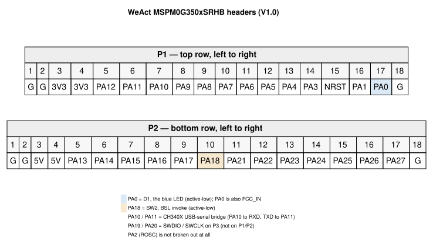
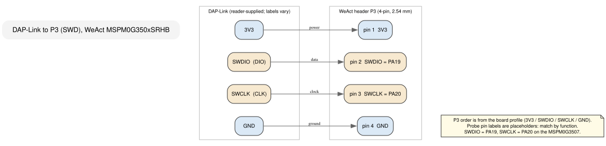

```{=latex}
\part{Foundations}
```

# 1 — The board, the SDK, and the loop

On your desk there are two things that do not yet know about each other: a
WeAct MSPM0G350xSRHB Core Board, and a folder full of TI's MSPM0 SDK. This
chapter introduces them, and then closes the only gap that matters before you
can learn anything else — the gap between a board that is powered and a board
that is running code you compiled. By the end you will have a lit LED blinking
under software you built and flashed, and you will know the two commands that
got it there. That is the loop, and every later chapter is a variation on it.

The chapter is shaped like a beginner's afternoon: meet the hardware, check you
have the tools, build, flash, watch. Everything else — the failure modes, the
one API call that does the visible work, what the other chapters will open up —
comes *after* the LED is blinking, because none of it matters until then.

The spine is one sentence:

> **Close the loop once, on purpose, so every later chapter starts from a
> known-good build rather than from a broken toolchain.**

## Meet the board

This is a core board, not a LaunchPad. It has no onboard debugger, no
general-purpose user button, and a single blue LED. Four things on it matter in
this chapter; the rest can wait. Every claim below resolves to the board profile
(`boards/weact-mspm0g3507srhb.md`) and, underneath it, the schematic
(`boards/WeAct-MSPM0G3507SRHBCoreBoard_V10 SchDoc.pdf`).

- **USB-C (J1) does two jobs.** It powers the board, and it carries a CH340X
  USB-to-serial bridge wired to PA10 (RX) and PA11 (TX) — so a plain USB cable
  also gives you a serial port. Profile: *Power* and *Secondary: BSL over USB
  serial*.
- **P3 is the debug header.** Four pins, 2.54 mm, in the order
  `3V3 / SWDIO / SWCLK / GND`. SWDIO is PA19 and SWCLK is PA20. This is where
  the DAP-Link goes. Profile: *Primary: SWD via external DAP-Link* and
  *P3 — 4-pin SWD header*.
- **D1 is the LED.** Blue, driven by **PA0**, and **active-low**: pulling the
  pin low lights it, driving it high turns it off. Remember "active-low" — it
  shows up again the moment you reason about what you see. Profile: *Onboard
  indicators and controls*.
- **SW1 resets, SW2 invokes the bootloader.** SW1 is the reset button (NRST).
  SW2 pulls PA18 low to request the ROM bootloader on power-up; it is the
  escape hatch you will meet near the end of this chapter. Profile: *Onboard
  indicators and controls* and *Secondary: BSL over USB serial*.

The board breaks the MCU out onto two 18-pin rows. You can ignore most of the
pins for now, but two of them are worth finding before you plug anything in:
PA0 is on P1 (pin 17, the second-to-last pin on the top row), and PA19/PA20 are
**not** on P1 or P2 at all — they leave the board only through P3. If you later
wonder why a pin isn't where you expect, check the map first.



One more thing the profile is explicit about: there is **no crystal on this
board**. The MCU runs from its internal SYSOSC (32 MHz by default) and LFOSC.
That is enough for everything in Part I and most of the book; chapters that
would otherwise assume a crystal will say so.

## What you need on the desk

You need five things. The installation of each belongs to the front matter of
this guide, not to a chapter, so this is only the checklist:

1. **A WeAct MSPM0G350xSRHB Core Board**, powered over USB-C.
2. **A USB-C cable** — for power now, and for the serial/BSL path later.
3. **A DAP-Link probe and four dupont wires.** The board has no debugger of its
   own; the DAP-Link is what talks SWD. Profile: *Primary: SWD via external
   DAP-Link*.
4. **The GNU Arm toolchain** (`arm-none-eabi-gcc` and friends). Every Makefile
   in `examples/` invokes it by that prefix.
5. **PyOCD**, the flashing tool. The repo's suggested Makefile names it
   directly: `PYOCD_TARGET = MSPM0G3507`, and its `flash:` target runs PyOCD
   (`sources/makefile/Makefile`, `flash:`). Profile: *Primary: SWD via external
   DAP-Link*.

The SDK itself is already vendored in this repository at
`sources/mspm0-sdk`, pinned to MSPM0 SDK `2.09.00.01` (`SDK_VERSION.md`). You do
not need to download it; you only need to know where it is, because the
Makefiles reach into it for the startup code and `driverlib.a`.

## The one example you will flash

Rather than write a program from nothing, you will flash one that TI already
wrote and this guide has already made board-correct: the SDK's
`gpio_toggle_output` example, in
`sources/mspm0-sdk/examples/nortos/LP_MSPM0G3507/driverlib/gpio_toggle_output/`.

That seed is written for TI's LaunchPad, whose LEDs hang off four GPIOB pins.
This board has one LED on PA0. The port is small and mechanical, exactly as the
board profile's *Seed-example porting rule* describes — replace the pin
declaration, rebuild — and the chapter's example at `examples/01-blink/` is the
result. You will not write any of this yourself yet. You will *use* it, and then
later chapters will open the hood:

- Chapter 2 unpacks what runs before `main()`.
- Chapter 3 reads the generated `ti_msp_dl_config.c` line by line.
- Chapter 4 shows the same initialization written by hand.

For now, treat `examples/01-blink/` as a sealed, known-good capsule. Its whole
program is a `main` that calls one generated init function once, then toggles a
pin forever:

```c
#include "ti_msp_dl_config.h"

#define BLINK_CYCLES (16000000)

int main(void)
{
    SYSCFG_DL_init();

    while (1) {
        delay_cycles(BLINK_CYCLES);
        DL_GPIO_togglePins(GPIO_LEDS_PORT, GPIO_LEDS_USER_LED_PIN);
    }
}
```

(`examples/01-blink/main.c`)

`SYSCFG_DL_init()` is not a DriverLib function. It is a generated function whose
name describes what it does: initialize the system configuration. Everything it
calls — power, pin mux, clock — is ordinary DriverLib, and Chapter 3 will show
you each line. `DL_GPIO_togglePins()` is the one DriverLib symbol this chapter
actually teaches; it gets its full treatment below, once you have seen it work.

## Build it

From the repository root:

```
make -C examples/01-blink
```

That command is documented in the example itself — `examples/01-blink/Makefile`
and `examples/01-blink/README.md` — and it produces three files under
`examples/01-blink/build/`: the ELF, the raw binary `blink.bin`, and `blink.map`.
A clean build finishes with a memory report like this:

```
Memory region         Used Size  Region Size  %age Used
           FLASH:         504 B       128 KB      0.38%
            SRAM:           0 B        32 KB      0.00%
```

If you see numbers in that shape, the build is good. The toolchain found the
SDK, the linker script, and `driverlib.a`, and produced a 504-byte image.

## Flash it

Now the board. Wire the DAP-Link to P3 and power the board over USB-C. Your
probe's own pin labels may not match the order below — probes differ, and some
print `DIO`/`CLK` instead of `SWDIO`/`SWCLK` — so **match by function, not by
position**. The P3 side is fixed and comes from the board profile.




| P3 pin | Signal | Connects to (generic DAP-Link) |
| --- | --- | --- |
| 1 | 3V3 | probe 3V3 / VTref |
| 2 | SWDIO (PA19) | probe SWDIO / DIO |
| 3 | SWCLK (PA20) | probe SWCLK / CLK |
| 4 | GND | probe GND |

With the probe connected and the board powered, flash the binary:

```
pyocd load --target MSPM0G3507 build/blink.bin
```

This is the repo's suggested flash command, taken from the `flash:` target of
`sources/makefile/Makefile`:

```make
flash: $(BUILD_DIR)/$(TARGET).bin
	pyocd load --target $(PYOCD_TARGET) $(BUILD_DIR)/$(TARGET).bin
```

PyOCD discovers the CMSIS-DAP probe on its own; there is no configuration file
to supply, and this repository ships none. The only thing the command needs from
you is the target name, `MSPM0G3507`, which is the `PYOCD_TARGET` value in that
same Makefile.

## What success looks like

D1 — the blue LED on PA0 — comes up **lit**, then blinks: roughly half a second
on, half a second off. It comes up lit rather than dark because D1 is active-low
and the generated init *clears* PA0, and clearing an active-low pin turns it on.
That small asymmetry is your first piece of real board behavior, and it is worth
noticing: the same code that would leave an active-high LED dark leaves this one
bright.


That is the loop, closed. Edit `main.c`, run the build command, run the flash
command, watch the LED. Everything else in this book happens inside this loop.

If the LED is not blinking, do not start editing code. Run the three checks
below first; in the overwhelming majority of first sessions the fault is wiring
or power, not software.

## When it doesn't work

These are the three failures that account for most first-time "it won't flash"
sessions on a bare core board. The symptoms are what the tools report; they are
general SWD/board behavior, not facts the board profile documents, so treat them
as a checklist rather than a source.

| What's wrong | What you see |
| --- | --- |
| The DAP-Link is not enumerated by the host | PyOCD reports that it found no available probe (no CMSIS-DAP device). Re-seat the probe's USB cable, check it is a data cable, and confirm the host sees it. |
| The board is not powered from USB-C | The probe enumerates, but PyOCD cannot connect: it sees a probe and no target. Plug in USB-C and confirm the board's power rail. |
| SWDIO and SWCLK are swapped | The probe enumerates, the target does not respond, and a connect fails the same way it would with no target. Re-check pins 2 and 3 against the table above — this is the one people get wrong while convinced they did not. |

Two more that are not wiring:

- **A probe whose labels are not the ones in the table.** Same remedy: match by
  function. `SWDIO`/`DIO` and `SWCLK`/`CLK` name the same two signals.
- **Editing the `.syscfg` and expecting the build to pick it up.** It will not.
  The example ships committed generated files (`ti_msp_dl_config.c/.h`) and
  builds them directly, exactly as described in the front matter's hardware and
  software section. Regenerating from `01-blink.syscfg` needs a SysConfig
  installation, which this repository does not ship and does not require. If you
  change the declaration without regenerating, you are editing a comment.

## The BSL escape hatch

If SWD is genuinely unavailable to you — a dead probe, a locked part, no DAP-Link
at all — the board has a second door. Hold **SW2** (which pulls PA18 low) during
power-on or reset, and the chip enters its ROM bootloader; because the CH340X
bridges PA10/PA11 to USB-C, you can then talk to that bootloader over a plain
USB cable with no extra hardware. The board profile describes both halves:
*Secondary: BSL over USB serial*, and *SW2 ... active low on PA18*. This is not
the path the guide leads with — SWD is faster, and it also gives you a debugger
— but it is worth knowing the door exists before you need it. Chapter 25 takes
the boot paths apart properly.

## The one line that does the visible work

Everything above is scaffolding around a single toggle. That toggle is the only
DriverLib symbol this chapter teaches, so it gets the full treatment. It lives
in `sources/mspm0-sdk/source/ti/driverlib/dl_gpio.h` (line 2313):

```c
__STATIC_INLINE void DL_GPIO_togglePins(GPIO_Regs* gpio, uint32_t pins);
```

- `gpio` — the register-overlay pointer for the port. Here it is `GPIOA`, which
  the generated header defines as `GPIO_LEDS_PORT`.
- `pins` — the pins to flip, as a bitwise OR of `DL_GPIO_PIN_*`. Here it is
  `GPIO_LEDS_USER_LED_PIN`, which is `DL_GPIO_PIN_0`.
- **Returns** `void`.
- **How it works:** it writes `pins` to the port's `DOUTTGL31_0` register
  (`dl_gpio.h:2315`). The GPIO block flips those output bits in hardware. There
  is no read-modify-write by the CPU, so the toggle cannot lose a race with
  another writer on a different pin.
- **Caveat:** toggling only affects a pin whose output is already *enabled*.
  This example gets that for free because the generated init called
  `DL_GPIO_enableOutput()` before `main` ran. When you write initialization by
  hand in Chapter 4, enabling the output is a step you have to remember.

The pacing comes from `delay_cycles`, which is a macro, not a DriverLib
function: `ti/driverlib/m0p/dl_core.h:115` defines it as an alias for
`DL_Common_delayCycles()`, declared in `ti/driverlib/dl_common.h:93`. It
busy-waits for *at least* the requested number of CPU cycles; the header is
careful to say "at least", notes a typical variance of about ten cycles, and
recommends a timer if you need an exact interval. At the 32 MHz default, the
macro's argument of 16 000 000 lands near half a second. Chapter 4 unpacks the
helper along with the rest of the lifecycle.

## Where the other chapters pick up

This chapter deliberately stopped at "it blinks." The three questions it left
open are the next three chapters:

- **What actually ran?** Your C is not the first code on the chip. Chapter 2
  follows the reset vector through the startup code and linker script to
  `main`.
- **What did `SYSCFG_DL_init()` do?** Chapter 3 opens
  `ti_msp_dl_config.c` and reads every generated call.
- **Why does initialization have this order at all?** Chapter 4 gives the one
  shape — power, configure, enable, use, disable — that every `dl_*.h` follows.

And one question waits until Part II: how fast is the chip actually running?
Chapter 5 owns the clocks. For now, the 32 MHz reset default is enough, and the
blink you are watching is proof that the loop works end to end.

## Common mistakes

**Reading the LED backward.** D1 is active-low. A cleared PA0 means *on*. If you
"fix" the polarity by setting the pin, you will make it darker, not brighter.

**Assuming the seed blinks the right pin.** The SDK's `gpio_toggle_output` is
mapped to the LaunchPad's GPIOB LEDs. It has been ported to PA0 here; do not
copy the four-pin initial state block from the TI seed into a WeAct build and
expect the same LED.

**Looking for PA19/PA20 on P1 or P2.** They are not broken out there. SWD leaves
the board only through P3. Profile: *P1*, *P2*, *P3*.

**Blaming the toolchain before the wires.** A failed flash on a bare core board
is usually power or SWD wiring. Check those two before you reinstall anything.

**Editing `ti_msp_dl_config.c` by hand.** It is generated output. With no
SysConfig installed, your edit survives this build and confuses the next reader;
when you *do* regenerate, it will be overwritten. Change the `.syscfg` — and
regenerate — or write your own initialization, as Chapter 4 does.

## Exercises

1. Change `BLINK_CYCLES` to `8000000`, rebuild, and re-flash. Predict the new
   blink rate before you look. (At 32 MHz, what fraction of a second is eight
   million cycles?)
2. Delete the `delay_cycles(BLINK_CYCLES)` line and re-flash. Describe what you
   see and explain it. (Hint: the CPU toggles far faster than your eye can
   follow, so the LED's *average* brightness changes.)
3. Open `examples/01-blink/ti_msp_dl_config.h` and find the three `GPIO_LEDS_*`
   names. Which one is a port, which is a pin mask, and which is a PINCM index?
   You do not need the answer to make this chapter work; you will in Chapter 4.
4. Re-wire the DAP-Link with SWDIO and SWCLK deliberately swapped, then try to
   flash. Record the exact error PyOCD prints — it is the same failure you will
   see in the field, and now you will recognize it instantly. Swap them back.
5. Flash the *original* TI seed (before porting) and observe that nothing useful
   happens on D1. Explain why in one sentence using the pin map in this chapter.

## Build the example

```
make -C examples/01-blink
```

It produces `examples/01-blink/build/blink.elf`, `build/blink.bin`, and
`build/blink.map`. `make -C examples/01-blink clean` removes them. See
`examples/01-blink/README.md` for the flash command and the expected behavior.

## Further reading

- `boards/weact-mspm0g3507srhb.md` — the board profile: power, P1/P2/P3,
  D1/SW1/SW2, debug workflows, the no-crystal note, and the seed porting rule.
- `boards/WeAct-MSPM0G3507SRHBCoreBoard_V10 SchDoc.pdf` — the schematic the
  profile summarizes.
- `sources/makefile/Makefile` — the suggested project Makefile; `PYOCD_TARGET`
  and the `flash:` target are the source of the PyOCD command.
- `sources/mspm0-sdk/examples/nortos/LP_MSPM0G3507/driverlib/gpio_toggle_output/`
  — the seed this chapter's example ports.
- `examples/01-blink/` — the ported seed: `main.c`, the committed generated
  `ti_msp_dl_config.c/.h`, `01-blink.syscfg`, the linker script, and the README.
- `sources/mspm0-sdk/source/ti/driverlib/dl_gpio.h:2313` — `DL_GPIO_togglePins`.
- `sources/mspm0-sdk/source/ti/driverlib/dl_common.h:93` and
  `sources/mspm0-sdk/source/ti/driverlib/m0p/dl_core.h:115` — `delay_cycles` and
  `DL_Common_delayCycles`.
- `SDK_VERSION.md` — the pinned SDK version, `mspm0_sdk_2_09_00_01`.
