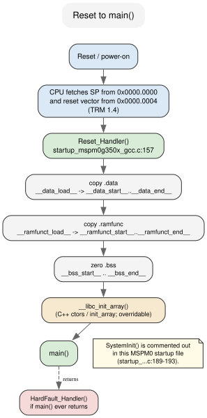
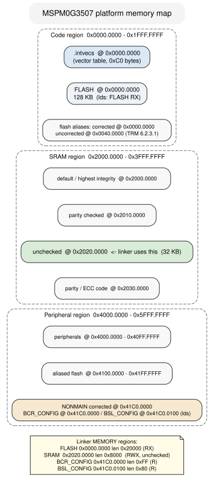

# 2 — What actually runs

Chapter 1 left you with a build command and a flash command, and a blinking
LED at the end of both. That is a working loop. It is also a lie of omission:
the program you flashed is not `main()`. Between the flash you wrote and the
first line of your C there is a vector table, a startup routine, and a linker
script, and none of them are yours. They are what the toolchain wires around
your code, and if you do not know they exist you will misread every `.map`,
every memory fault, and every "but I only have five globals" surprised look.

This chapter is a reference, not a build-it. You will open four real files and
one real artifact — the vector table, the startup source, the GNU linker
script, and the `.map` produced by the example's build — and read them the way
you would read a schematic. By the end you will be able to take any MSPM0
`.elf`, find `main` in it, say exactly which addresses it will touch and in
what order, and explain why the number at address zero is a stack pointer.

The spine is one sentence long:

> **The chip knows only the reset vector. Everything after that is the
> linker's and the startup code's convention.**

There is no DriverLib API to teach here. This chapter touches no `dl_*.h`
header and calls no `DL_*` function. That is not a gap — it is the point.
Chapter 3 and Chapter 4 are about the functions that configure peripherals;
this chapter is about the machinery that gets the CPU to them.

## The one thing the chip knows

Reset is a hardware event. The CPU does not look for a symbol called `main`,
and it does not read the ELF header's "entry point". On the MSPM0 it does
exactly one thing, described in the TRM
(`sources/trm/slau846c.txt`, *Section 1.4, Boot Configuration*): it fetches
two words from the bottom of flash — the initial stack pointer at
`0x0000.0000` and the reset vector at `0x0000.0004` — and jumps.

Those two words are the first two entries of the vector table. In the SDK's
startup file
(`sources/mspm0-sdk/source/ti/devices/msp/m0p/startup_system_files/gcc/startup_mspm0g350x_gcc.c`;
the seed ships a byte-identical copy at
`.../examples/nortos/LP_MSPM0G3507/driverlib/empty_non_sysconfig/gcc/startup_mspm0g350x_gcc.c`)
it is a plain array:

```c
void (* const interruptVectors[])(void) __attribute__ ((used)) __attribute__ ((section (".intvecs"))) =
{
    (pFunc)&__StackTop,                    /* The initial stack pointer */
    Reset_Handler,                         /* The reset handler         */
    NMI_Handler,                           /* The NMI handler           */
    HardFault_Handler,                     /* The hard fault handler    */
    0,                                     /* Reserved                  */
    ...
    SysTick_Handler,                       /* SysTick handler           */
    GROUP0_IRQHandler,                     /* GROUP0 interrupt handler  */
    ...
};
```

(startup_mspm0g350x_gcc.c:97-148)

Three details in that opening line matter more than the entries:

- `section (".intvecs")` says "do not put this with the other data; put it in
  a section I named." The linker script decides where `.intvecs` lives.
- `used` tells the compiler to keep the array even though nothing in C refers
  to it by name.
- The entries are `__attribute__((weak, alias("Default_Handler")))`
  (startup_mspm0g350x_gcc.c:61-91). Each interrupt handler is a weak alias to
  a do-nothing trap, so you can define `UART0_IRQHandler` in your own file and
  the linker prefers yours. Chapter 3 reuses this exact word — "the linker
  prefers yours" — for SysConfig's generated functions; it is the same
  mechanism.

The array is 48 words long, 192 bytes (TRM *Section 3.3.2, Interrupt and
Exception Table*), and the example's `.map` confirms the size:

```
 .intvecs        0x00000000       0xc0
 *(.intvecs)
 .intvecs       0x00000000       0xc0 build/startup_mspm0g350x_gcc.o
                0x00000000                interruptVectors
```

(`examples/02-what-runs/build/what-runs.map`)

`0xc0` is 192. `interruptVectors` sits at address `0x00000000`. That is not a
coincidence of this program; the linker script forces it, and we will see how
in a moment.

### The trap: the ELF entry point is not the reset vector

Ask `readelf` where the example starts and it answers `0xc0`:

```
Entry point address:               0xc0
```

That is the first byte of `.text`, not the reset handler. It is a leftover
convention from hosted operating systems, and the MSPM0 hardware never looks
at it. The thing the chip actually jumps to is the second word of
`.intvecs`, which the startup file fills with `Reset_Handler`:

```
0000 00802020 f1000000 ed000000 ed000000
```

(`arm-none-eabi-objdump -s -j .intvecs build/what-runs.elf`)

Read those little-endian words: `0x20208000` is the stack pointer, and
`0x000000f1` is `Reset_Handler` at `0x000000f0` with the Thumb bit set.
`Reset_Handler` is nowhere near the ELF entry point, and that is fine.

## Reset_Handler does four jobs and then calls main

Once the CPU lands on `Reset_Handler`, the C runtime is not ready. An
initialized global's value is sitting in flash, not at the SRAM address the
code will read; `.bss` holds whatever the last power cycle left in SRAM; and
C++ constructors have not run. The startup file handles that. Its whole body is
short enough to read in one sitting (startup_mspm0g350x_gcc.c:157-210):

```c
void Reset_Handler(void)
{
    uint32_t *pui32Src, *pui32Dest;

    /* Copy the data segment initializers from flash to SRAM. */
    pui32Src = &__data_load__;
    for(pui32Dest = &__data_start__; pui32Dest < &__data_end__; )
        *pui32Dest++ = *pui32Src++;

    /* Copy the ramfunct segment initializers from flash to SRAM. */
    pui32Src = &__ramfunct_load__;
    for(pui32Dest = &__ramfunct_start__; pui32Dest < &__ramfunct_end__; )
        *pui32Dest++ = *pui32Src++;

    /* Initialize .bss to zero */
    for(bs = &__bss_start__; bs < &__bss_end__; ) *bs++ = 0;

    /*
     * System initialization routine can be called here, but it's not
     * required for MSPM0.
     */
    // SystemInit();

    __libc_init_array();

    main();

    HardFault_Handler();
}
```

Those `__data_load__` and friends are not C library names and they are not
compiler builtins. They are symbols the linker script manufactures so the
startup code has addresses to loop over. Every one of them is defined in
`mspm0g3507.lds` — we will meet each below.

Four things to notice, because each is a hole you can fall into:

1. **`.data` is copied from flash to SRAM.** An initialized global has two
   addresses: a *load* address in flash (where the bytes are burned) and a
   *run* address in SRAM (where the code reads them). The startup loop is the
   bridge. We will see both addresses in the `.map`.
2. **`.bss` is zeroed, not copied.** Zero-initialized globals take no flash
   space; they only cost SRAM and a memset.
3. **`.ramfunc` is copied too.** Functions marked into `.ramfunc` live in
   SRAM but are loaded from flash. This is how you run code during flash
   erase, and it is one more copy loop.
4. **`main()` is a normal function call.** If it returns, the startup code
   calls `HardFault_Handler()`. `main` is not expected to return, which is why
   every example you have seen ends in `while (1)`.



### `__libc_init_array`, the hook you keep overriding

Chapter 4's manual LED and Chapter 3's SysConfig LED both define an empty
`void __libc_init_array(void) { }` in `main.c`. This is why it exists. The
startup file declares it `extern` and calls it (startup_mspm0g350x_gcc.c:56,
:199). In a normal hosted toolchain it lives in newlib and walks the
`.init_array` / `.preinit_array` lists, running C++ constructors before
`main`. On a bare-metal program with no constructors, it does nothing useful —
and if you link no newlib, it does not exist at all. Defining your own empty
version satisfies the call and lets the example link against libgcc alone.

The SDK's own `empty_non_sysconfig` seed makes the opposite choice: it does
*not* define the hook, and its makefile links newlib's version along with `-lc
-lm --specs=nano.specs --specs=nosys.specs`
(`.../empty_non_sysconfig/gcc/makefile:41-45`). Our example:
`examples/02-what-runs/Makefile` links `-lgcc` only and supplies the empty
hook. Both routes reach `main` the same way; only the ownership of that one
function differs.

One more weak symbol earns its keep in the startup file: `_init` is declared
`__attribute__((weak, alias("initStub")))`, and `initStub` is an empty stub
(startup_mspm0g350x_gcc.c:57-58). Newlib's `__libc_init_array` calls `_init`
and `_fini`; the alias guarantees the call lands somewhere harmless when
nothing else defines them.

## The linker script is the other half of the program

Everything the startup code promised — that `.data` has a load address and a
run address, that `.intvecs` is at zero, that `__StackTop` is a real number —
the linker script is what makes true. The example's script is
`examples/02-what-runs/mspm0g3507.lds`, copied verbatim from the seed at
`.../empty_non_sysconfig/gcc/mspm0g3507.lds` (the two files are
byte-identical; `diff` reports no difference). It begins by declaring the
device's memory:

```
MEMORY
{
    FLASH           (RX)  : ORIGIN = 0x00000000, LENGTH = 0x00020000
    SRAM            (RWX) : ORIGIN = 0x20200000, LENGTH = 0x00008000
    BCR_CONFIG      (R)   : ORIGIN = 0x41C00000, LENGTH = 0x000000FF
    BSL_CONFIG      (R)   : ORIGIN = 0x41C00100, LENGTH = 0x00000080
}
```

(mspm0g3507.lds:39-46)

That is 128 KB of flash and 32 KB of SRAM, the sizes the datasheet gives for
the MSPM0G3507 (`sources/datasheet/mspm0g3507.txt`, "128KB flash, 32KB RAM").
The two `*_CONFIG` regions are read-only links into the NONMAIN flash area
where the boot configuration and bootloader configuration live; their
addresses sit under the aliased-flash window that TRM *Section 1.3.3* places
at `0x4100.0000–0x41FF.FFFF`.

### SRAM starts at 0x2020.0000 on purpose

Notice the SRAM origin: `0x20200000`, not the obvious `0x20000000`. The TRM's
SRAM region map (TRM *Section 1.3.2, SRAM Region*, Table 1-2) aliases the same
physical SRAM into four subregions that differ only in the integrity check
applied on access:

| Subregion | Base | Check applied |
| --- | --- | --- |
| default | `0x2000.0000` | highest available (ECC, else parity) |
| parity checked | `0x2010.0000` | parity |
| **unchecked** | `0x2020.0000` | none |
| parity/ECC code | `0x2030.0000` | the code bytes themselves |

The linker script picks the **unchecked** window. That choice is deliberate,
and the TRM explains why it is the safe one (and recommends it): on a device
with ECC or parity, spinning up the checked windows means every uninitialized
read — and reset leaves SRAM random — can raise a parity or ECC error and hard-
fault the CPU before your first line of code runs. Linking into
`0x2020.0000` sidesteps the whole class of problem. If you ever move the SRAM
origin back to `0x20000000` "to be tidy", you have turned integrity checking
back on for a region the startup code reads before it writes.

### Where each section goes

After `MEMORY`, the script maps C section names onto those regions with
`REGION_ALIAS` (mspm0g3507.lds:50-61), then defines the output sections. The
ones that matter to the startup flow:

**The vector table must be at zero.** The script provides an override hook and
defaults it to `0x00000000`, then keeps the section there:

```
PROVIDE (_intvecs_base_address =
    DEFINED(_intvecs_base_address) ? _intvecs_base_address : 0x00000000);

.intvecs (_intvecs_base_address) : AT (_intvecs_base_address) {
    KEEP (*(.intvecs))
} > REGION_TEXT
```

(mspm0g3507.lds:67-72)

`KEEP` is what stops the linker's `--gc-sections` from throwing the table away
because no C code references it by name. If `KEEP` were missing, the reset
vector would be garbage and the chip would fault on the first instruction.

**Initialized data has a load address and a run address.** This is the `.data`
section, and `AT>` is the part that says so:

```
.data : {
    __data_load__ = LOADADDR (.data);
    __data_start__ = .;
    KEEP (*(.data))
    KEEP (*(.data*))
    . = ALIGN (8);
    __data_end__ = .;
} > REGION_DATA AT> REGION_TEXT
```

(mspm0g3507.lds:149-156)

Read `> REGION_DATA AT> REGION_TEXT` as "run in SRAM, load from flash." `AT>`
sets the load address; without it, the initializer bytes would vanish. The
three symbols are exactly the ones `Reset_Handler` loops over.

**`.ramfunc` is the same trick for code** (mspm0g3507.lds:97-103): run in
`REGION_TEXT_RAM` (SRAM), load from `REGION_TEXT` (flash), with
`__ramfunct_load__`, `__ramfunct_start__`, `__ramfunct_end__` for the copy
loop. **`.bss`** is a plain SRAM section with `__bss_start__` / `__bss_end__`
(mspm0g3507.lds:158-166). **`.rodata`** is read-only in flash
(mspm0g3507.lds:105-110).

**`.noinit` is the exception that proves the pattern.** It gets its own SRAM
section with no copy and no zero (mspm0g3507.lds:168-172), so the startup code
simply leaves it alone.

**The stack is placed by arithmetic, not by bytes.** The script reserves a
zero-length `.stack` section and then defines the top of the stack as the top
of the whole SRAM region:

```
.stack (NOLOAD) : ALIGN(0x8) {
    _stack = .;
    KEEP(*(.stack))
} > REGION_STACK AT> REGION_STACK
...
__StackTop = ORIGIN(REGION_STACK) + LENGTH(REGION_STACK);
PROVIDE(__stack = __StackTop);
```

(mspm0g3507.lds:184-200)

`ORIGIN(SRAM) + LENGTH(SRAM)` is `0x20200000 + 0x8000 = 0x20208000`. That is
the value the vector table's first word holds. Nothing *reserves* the stack;
the stack grows down from `__StackTop` into the space the script left over.
The heap is the mirror image — a growing-up region starting where `.bss` (and
`.noinit`) end. The two cursors grow toward each other.

The script's opening comment says `_Min_Heap_Size` and `_Min_Stack_Size`
"generate a link error if heap and stack don't fit into RAM"
(mspm0g3507.lds:34-36) — but in this script the two symbols are defined and
never used. There is no `ASSERT` on them anywhere. The promised check is
aspirational here, so the stack/heap boundary is yours to respect: size the
stack for your deepest call chain, and if you use `malloc`, remember the heap
has no floor at all.



## The `.map` is the receipt

Every claim above has a number attached once you link, and the linker will
print it. The GNU toolchain writes it to `build/what-runs.map` because the
Makefile passes `-Wl,-Map=build/what-runs.map` (`examples/02-what-runs/Makefile`,
`LDFLAGS`). Open it alongside the script; the two read like a question and its
answer.

The link opens with the memory it was given — the four regions straight from
`MEMORY`:

```
Memory Configuration

Name             Origin             Length             Attributes
FLASH            0x00000000         0x00020000         xr
SRAM             0x20200000         0x00008000         xrw
BCR_CONFIG       0x41c00000         0x000000ff         r
BSL_CONFIG       0x41c00100         0x00000080         r
```

Then it walks the sections. The interesting lines for our tagged globals:

```
.ramfunc        0x20200000       0x20 load address 0x00000168
                0x00000168                        __ramfunct_load__ = LOADADDR (.ramfunc)
                0x20200000                        __ramfunct_start__ = .
                0x20200000                run_from_ram
...
.rodata         0x00000188       0x10
                0x00000188                g_banner
...
.data           0x20200020        0x8 load address 0x00000198
                0x00000198                        __data_load__ = LOADADDR (.data)
                0x20200020                        __data_start__ = .
                0x20200020                g_initialized
...
.bss            0x20200028        0x8
                0x20200028                        __bss_start__ = .
                0x20200028                g_zero
...
.noinit         0x20200030        0x8
                0x20200030                g_survivor
...
                0x20208000                        __StackTop = (ORIGIN (REGION_STACK) + LENGTH (REGION_STACK))
```

(`examples/02-what-runs/build/what-runs.map`)

Read the `.data` line twice. `g_initialized` has *two* addresses:
`0x20200020`, where `main` will read it, and `0x00000198`, where the `0xDEADBEEF`
is physically stored in flash. `LOADADDR` is what makes the second address
available; `__data_load__` is that flash address. The same split appears in
`.ramfunc`: `run_from_ram` runs at `0x20200000` but its instructions are burned
at `0x00000168`. Now the startup loops stop being boilerplate and become
self-evidently necessary: without that `.data` copy, `g_initialized` would read
as `0` at runtime.

The whole program, in one table:

| Symbol | Section | Run address | Load address |
| --- | --- | --- | --- |
| `interruptVectors` | `.intvecs` | `0x00000000` | same |
| `Reset_Handler` | `.text` | `0x000000f0` | same |
| `main` | `.text` | `0x000000c4` | same |
| `g_banner` | `.rodata` | `0x00000188` | same |
| `run_from_ram` | `.ramfunc` | `0x20200000` | `0x00000168` |
| `g_initialized` | `.data` | `0x20200020` | `0x00000198` |
| `g_zero` | `.bss` | `0x20200028` | — (no image) |
| `g_survivor` | `.noinit` | `0x20200030` | — (no image) |
| `__StackTop` | `.stack` | `0x20208000` | — |

(`arm-none-eabi-nm build/what-runs.elf`, cross-checked against the `.map`)

`.bss` and `.noinit` have no load address because they contribute nothing to
the flash image. You can watch that directly in the `.bin`: it is 416 bytes
(`ls -l build/what-runs.bin`), and `g_zero` and `g_survivor` are not in it. The
ELF's `.bss` and `.noinit` section headers say `NOBITS`, the linker's word for
"addresses only, no file bytes"
(`arm-none-eabi-readelf -S build/what-runs.elf`).

One line in the map has no obvious author and deserves a name. We compiled
`main.c` into one object and the startup file into another, and `main` calls
`run_from_ram`, which the linker has placed in SRAM — over 500 MB away,
beyond the roughly ±16 MB reach of a single ARMv6-M branch. So the linker
synthesizes a trampoline:

```
 .text.initStub.__stub
                0x00000158       0x10 linker stubs
...
                0x00000158                __run_from_ram_veneer
```

(`examples/02-what-runs/build/what-runs.map`, `arm-none-eabi-nm`)

You did not write `__run_from_ram_veneer`. The linker added it, and it appears
in the map under "linker stubs". Any time you move a function to `.ramfunc` or
call across regions, expect to see these show up — and expect them to be
counted against flash.

## What the seed ships versus what this example builds

The chapter's seed is the SDK's `empty_non_sysconfig`. Our example is that
seed plus five tagged globals; the startup file and linker script are
byte-identical, and the build wiring is the same shape. The one honest
difference is the C library:

| | SDK seed `empty_non_sysconfig/gcc/makefile` | `examples/02-what-runs/Makefile` |
| --- | --- | --- |
| Link | `-nostartfiles -l:driverlib.a -T mspm0g3507.lds` | same |
| Map | `-Wl,-Map,$(NAME).map` | `-Wl,-Map=$(BUILD_DIR)/what-runs.map` |
| C library | `-lgcc -lc -lm --specs=nano.specs --specs=nosys.specs` | `-lgcc` only |
| `__libc_init_array` | newlib's | overridden empty in `main.c` |
| `--gc-sections` | yes | yes |

The seed's other toolchain folders hold linker files we do not use, because
the guide is pinned to GNU Arm: `.../empty_non_sysconfig/iar/mspm0g3507.icf`,
`.../keil/mspm0g3507.sct`, and `.../ticlang/mspm0g3507.cmd` encode the same
regions with different syntax. Do not mix their semantics into a GNU Arm
build.

### Caveat: `--gc-sections` eats what nobody references

Both Makefiles link with `-Wl,--gc-sections`, so the linker discards any
section no kept section points to. The vector table survives only because the
script wraps it in `KEEP`. Your own globals are not so lucky: while building
this chapter, the first version of `run_from_ram` read `g_banner[0]`, the
compiler folded it to a constant, and the map's very first entry became

```
Discarded input sections

 .rodata.g_banner
                0x00000000        0xd build/main.o
```

(observed while developing this example; the shipped build's `.rodata` output
section is `0x10` bytes at `0x00000188`). Indexing through the
`volatile g_survivor` kept the read opaque, and the string reappeared. If a
constant you know you declared is missing from the map, look for it under
"Discarded input sections" before you look for a bug in your code.

## Common mistakes

**Reading the ELF entry point as the reset vector.** `readelf -h` says `0xc0`;
the chip jumps to `word[1]` of `.intvecs`. They are different numbers and only
the second one boots.

**Assuming `main` is the first code that runs.** It runs after `.data` is
copied, `.ramfunc` is copied, `.bss` is zeroed, and `__libc_init_array` returns.
If a global is wrong at the top of `main`, the bug is upstream, in the startup
or the linker script.

**Linking into `0x2000.0000` "because SRAM starts there".** `0x2000.0000` is the
ECC/parity-checked alias; the unchecked alias is `0x2020.0000`, and the SDK's
script deliberately uses it. Reading uninitialized checked SRAM can hard-fault
before your code runs (TRM 1.3.2).

**Expecting `.bss` to cost flash.** It does not; it is `NOBITS` and absent from
the `.bin`. If you need a large zeroed buffer, `.bss` is free in flash terms.

**Putting data you want retained across reset in `.noinit` and then assuming it
is initialized.** `Reset_Handler` deliberately does not touch `.noinit`; that is
its whole purpose.

**Forgetting `KEEP` when you add your own vector-like table.** A section that
nothing references disappears under `--gc-sections`. The SDK's `.intvecs` is
safe because the script keeps it; a table you invent is not.

## Exercises

1. Run `arm-none-eabi-objdump -s -j .intvecs build/what-runs.elf` and decode
   the first two words: what stack pointer and what reset address do they hold?
   Then find the `GROUP0_IRQHandler` entry. What address does it hold, and why
   is it the same as `Default_Handler`?
2. In `main.c`, change `g_initialized` to `0x0000BEEFu`. Rebuild and re-read
   the `.map`. Which address changed — the load address, the run address, or
   both?
3. Delete the `__attribute__((section(".ramfunc")))` from `run_from_ram`,
   rebuild, and find where `run_from_ram` and `__run_from_ram_veneer` land now.
   Explain the disappearance (or not) of the veneer.
4. Move the `SRAM` origin in `mspm0g3507.lds` from `0x20200000` to
   `0x20000000`, rebuild, and inspect the `Memory region` line the linker
   prints. What changed about the region, and what would happen on a device
   whose SRAM supports ECC when `Reset_Handler` reads an uninitialized word?
5. Define your own `Reset_Handler` in `main.c`. Does it link, and which
   definition wins? (The startup file's declaration is
   `__attribute__((weak))`, the same rule as the interrupt aliases.)
6. Change the `SRAM` `LENGTH` in `MEMORY` from `0x8000` to `0x20` and rebuild.
   What does the linker do? Then change `_Min_Stack_Size` and rebuild. Which
   of the two actually stops the build, and what does that tell you about the
   "generate a link error" comment (mspm0g3507.lds:34)?

## Build the example

```
make -C examples/02-what-runs
```

It produces `build/what-runs.elf`, `build/what-runs.bin`, and the chapter's
central artifact, `build/what-runs.map`.
`make -C examples/02-what-runs clean` removes them. See
`examples/02-what-runs/README.md` for the read-the-map checklist and the
optional debugger step.

## Further reading

- `sources/mspm0-sdk/source/ti/devices/msp/m0p/startup_system_files/gcc/startup_mspm0g350x_gcc.c`
  — the vector table, `Reset_Handler`, `Default_Handler`, and the
  `__libc_init_array` hook (byte-identical to the seed's copy at
  `examples/nortos/LP_MSPM0G3507/driverlib/empty_non_sysconfig/gcc/startup_mspm0g350x_gcc.c`)
- `sources/mspm0-sdk/examples/nortos/LP_MSPM0G3507/driverlib/empty_non_sysconfig/gcc/mspm0g3507.lds`
  — the `MEMORY` regions, `REGION_ALIAS`, and every output section the startup
  code depends on
- `sources/mspm0-sdk/examples/nortos/LP_MSPM0G3507/driverlib/empty_non_sysconfig/gcc/makefile`
  — the seed's link flags, including newlib and `--gc-sections`
- `sources/mspm0-sdk/examples/nortos/LP_MSPM0G3507/driverlib/empty_non_sysconfig/empty_non_sysconfig.c`,
  `.../ti_msp_dl_config.c`, `.../ti_msp_dl_config.h` — the seed this chapter modifies
- `examples/02-what-runs/build/what-runs.map` — the generated map quoted throughout
- `sources/trm/slau846c.txt` — Section 1.3 (Platform Memory Map: 1.3.1 Code,
  1.3.2 SRAM Region and Table 1-2 aliases, 1.3.3 Peripheral Region), Section
  1.4 (Boot Configuration and the reset-vector fetch), Section 3.3.2
  (Interrupt and Exception Table, 48 words), Section 6.2.3.1 (Flash Memory Map)
- `sources/datasheet/mspm0g3507.txt` — MSPM0G3507 128 KB flash / 32 KB SRAM
