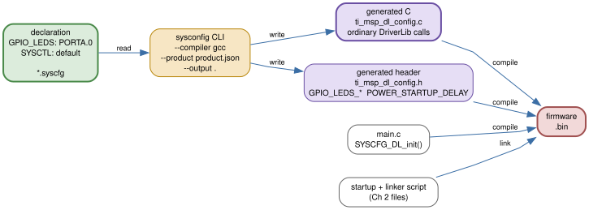

# 3 — SysConfig: declaring pins and clocks

By the end of Chapter 1 you had a blinking LED and two commands: one to build
it, one to flash it. Somewhere in that example a file called
`ti_msp_dl_config.c` did the setup, and you probably scrolled past it. This
chapter is about that file. You will open the declaration that produced it,
read the output line by line, and see that there is no magic in it — every call
could have been typed by hand.

That last point is the whole chapter. SysConfig is a **declarer**: you tell it
which pins and which clocks you want, and it writes ordinary DriverLib calls
that say exactly that. The GUI is a convenience over a text file, and the text
file compiles to C you can read. By the end you will hold a SysConfig-initialized
LED whose behavior is identical to the hand-written one in Chapter 4 — same
pin, same blink — differing only in who wrote the initialization. Keep both
examples open as you read; the comparison is the point.

The organizing idea is one line:

> **declaration in, DriverLib out**

Everything below is that line, applied to a real example.

## The declaration: a `.syscfg` file

Start with the file the SDK actually ships. The seed for this chapter is the
LaunchPad's `gpio_toggle_output` example, and its declaration is at
`sources/mspm0-sdk/examples/nortos/LP_MSPM0G3507/driverlib/gpio_toggle_output/gpio_toggle_output.syscfg`.
Strip the comments and it is tiny:

```js
//@cliArgs --device "MSPM0G350X" --package "LQFP-64(PM)" --part "Default"
//@v2CliArgs --device "MSPM0G3507" --package "LQFP-64(PM)"
// @cliArgs --board /ti/boards/LP_MSPM0G3507 --rtos nortos

const GPIO   = scripting.addModule("/ti/driverlib/GPIO", {}, false);
const GPIO1  = GPIO.addInstance();
const SYSCTL = scripting.addModule("/ti/driverlib/SYSCTL");

GPIO1.$name                         = "GPIO_LEDS";
GPIO1.port                          = "PORTB";
GPIO1.associatedPins.create(4);
GPIO1.associatedPins[0].$name       = "USER_LED_1";
GPIO1.associatedPins[0].assignedPin = "22";
/* ...three more pins... */

const Board = scripting.addModule("/ti/driverlib/Board", {}, false);

SYSCTL.forceDefaultClkConfig = true;
SYSCTL.clockTreeEn  = true;
```

Read it as a declaration, not as code. The `--cliArgs` lines name the device,
the package, and (here) a LaunchPad board template. The `GPIO1` block declares
one pin group called `GPIO_LEDS`, puts it on `PORTB`, and names four pins with
the LaunchPad's assignments. The `SYSCTL` block declares that clocks should be
left at the default configuration. That is the entire input.

This seed is pinned to the LaunchPad. On the WeAct board it is wrong in two
ways: the LED nets are not there, and the board template does not describe our
schematic. So the chapter's example ships a ported declaration at
`examples/03-sysconfig-led/03-sysconfig-led.syscfg`. The port is two edits, and
neither is a rewrite:

```js
//@cliArgs --device "MSPM0G350X" --package "LQFP-64(PM)" --part "Default"
//@v2CliArgs --device "MSPM0G3507" --package "LQFP-64(PM)"

/* ...GPIO1 and SYSCTL modules... */

GPIO1.port                          = "PORTA";
GPIO1.associatedPins.create(1);
GPIO1.associatedPins[0].$name       = "USER_LED";
GPIO1.associatedPins[0].assignedPin = "0";
```

The `--board` line is gone: instead of loading the LaunchPad template, this
config targets `MSPM0G3507` directly and assigns the pin by hand. The device-only
form is exactly what the SDK's own custom-board template does; compare
`sources/mspm0-sdk/examples/nortos/CUSTOM_BOARD/driverlib/empty_mspm0g3507/empty_mspm0g3507.syscfg`,
which imports only `SYSCTL`, `ProjectConfig`, and an empty `Board`. The four
LaunchPad pins collapse to one, on `PORTA` pin `0` — the pin the WeAct schematic
wires to D1.

Two honest caveats about this declaration live in the file and in the example
README, and they will bite you if you regenerate it:

- **The package line still says `LQFP-64(PM)`.** Every MSPM0G3507 `.syscfg` in
  the SDK uses that package; no example uses the WeAct part's 32-pin QFN (RHB).
  Only pins that exist on RHB are assigned here (PA0 is one of them), but the
  package pin numbers SysConfig prints would be LQFP-64 numbers, not the RHB
  numbers on the WeAct top view.
- **This port was not produced by running SysConfig** — see [Build it](#build-it-the-generated-led)
  below. The declaration is shown so you can read it; the generated files are
  committed so the example builds without a SysConfig install.

## From declaration to DriverLib

Between the `.syscfg` and the C you compile there is one step. The SDK's makefile
drives it explicitly, at
`sources/mspm0-sdk/examples/nortos/LP_MSPM0G3507/driverlib/gpio_toggle_output/gcc/makefile`:

```make
SYSCFG_CMD_STUB = $(SYSCONFIG_TOOL) --compiler gcc --product $(MSPM0_SDK_INSTALL_DIR)/.metadata/product.json
...
syscfg: ../gpio_toggle_output.syscfg
	@ $(SYSCFG_CMD_STUB) --output $(@D) $<
```

That command reads the declaration and writes C and a header. The shape is worth
one diagram and no more:



The output is two files, and they are ordinary C. From here on, this chapter is
just reading them.

## Read the output: `ti_msp_dl_config.c`

The generated source for this chapter's example is
`examples/03-sysconfig-led/ti_msp_dl_config.c`. Its entry point is a three-line
function, and it is the first thing Chapter 4 leans on:

```c
SYSCONFIG_WEAK void SYSCFG_DL_init(void)
{
    SYSCFG_DL_initPower();
    SYSCFG_DL_GPIO_init();
    SYSCFG_DL_SYSCTL_init();
}
```

That is not a SysConfig quirk. It is the peripheral lifecycle from Chapter 4 —
power, then configure and enable, then the subsystem setup — made literal. The
generator grouped the calls the same way you would by hand. The three functions
below are the whole initialization; compare each one against Chapter 4's manual
blinker and the "generated" label stops being interesting.

### `SYSCFG_DL_initPower()` — the power stage

```c
SYSCONFIG_WEAK void SYSCFG_DL_initPower(void)
{
    DL_GPIO_reset(GPIOA);
    DL_GPIO_enablePower(GPIOA);
    delay_cycles(POWER_STARTUP_DELAY);
}
```

Both GPIO calls are in `sources/mspm0-sdk/source/ti/driverlib/dl_gpio.h`:

```c
__STATIC_INLINE void DL_GPIO_reset(GPIO_Regs* gpio);        /* dl_gpio.h:1882 */
__STATIC_INLINE void DL_GPIO_enablePower(GPIO_Regs* gpio);  /* dl_gpio.h:1835 */
```

`gpio` is the register-overlay pointer for the instance — here `GPIOA`, the
only port this example touches. Both return `void`. `DL_GPIO_reset()` forces
the block to its default state (TRM *Section 2.4.1.7, Peripheral Reset
Control*), and `DL_GPIO_enablePower()` opens the register interface; until it
runs, no other register in the block is configurable (TRM *Section 2.2.6,
Peripheral Enable*). The `delay_cycles(POWER_STARTUP_DELAY)` is the settle wait
that section requires — `POWER_STARTUP_DELAY` is defined as `16` in the
generated header, comfortably above the four ULPCLK cycles the TRM asks for.
The macro itself is an alias you met in Chapter 4:

```c
/* ti/driverlib/m0p/dl_core.h:115 */
#define delay_cycles(cycles) DL_Common_delayCycles(cycles)
/* ti/driverlib/dl_common.h:93 */
void DL_Common_delayCycles(uint32_t cycles);
```

### `SYSCFG_DL_GPIO_init()` — configure *and* enable

```c
SYSCONFIG_WEAK void SYSCFG_DL_GPIO_init(void)
{
    DL_GPIO_initDigitalOutput(GPIO_LEDS_USER_LED_IOMUX);

    DL_GPIO_clearPins(GPIO_LEDS_PORT, GPIO_LEDS_USER_LED_PIN);
    DL_GPIO_enableOutput(GPIO_LEDS_PORT, GPIO_LEDS_USER_LED_PIN);
}
```

Three calls, and they spell out the middle of the lifecycle exactly as Chapter 4
does:

```c
__STATIC_INLINE void DL_GPIO_initDigitalOutput(uint32_t pincmIndex);              /* dl_gpio.h:1910 */
__STATIC_INLINE void DL_GPIO_clearPins(GPIO_Regs* gpio, uint32_t pins);           /* dl_gpio.h:2298 */
__STATIC_INLINE void DL_GPIO_enableOutput(GPIO_Regs* gpio, uint32_t pins);        /* dl_gpio.h:2324 */
```

`DL_GPIO_initDigitalOutput()` takes a **PINCM index**, and this is the trap
Chapter 4 warns about: `GPIO_LEDS_USER_LED_IOMUX` is `IOMUX_PINCM1`, an index
into the IOMUX pin-control array, while `GPIO_LEDS_USER_LED_PIN` is
`DL_GPIO_PIN_0`, a bit in a GPIO data register. Two different namespaces. The
`pins` arguments are a bitwise OR of `DL_GPIO_PIN_*`, all three calls return
`void`.

The order matters and the generator got it right. `DL_GPIO_clearPins()` sets the
**idle level before the output is connected**, so the pin never glitches as it
becomes a driver. Then `DL_GPIO_enableOutput()` connects it. Chapter 4 calls
this "configure, then enable"; the generated code is that sentence.

The polarity is worth pausing on, because it is where the WeAct board differs
from the LaunchPad. The SDK seed clears its LED pin "to leave it off" because
that board's LED is active-high. D1 on WeAct is **active-low**: clearing PA0
turns the LED *on*. So this example comes up with D1 lit, then toggles. If you
wanted it to start dark you would swap the clear for its sibling
`DL_GPIO_setPins()` (`dl_gpio.h:2283`), which drives the pin high. Either way,
the idle level is chosen before `enableOutput()`, which is the rule that matters.

### `SYSCFG_DL_SYSCTL_init()` — the clock declaration

```c
SYSCONFIG_WEAK void SYSCFG_DL_SYSCTL_init(void)
{
    DL_SYSCTL_setBORThreshold(DL_SYSCTL_BOR_THRESHOLD_LEVEL_0);
    DL_SYSCTL_setSYSOSCFreq(DL_SYSCTL_SYSOSC_FREQ_BASE);
    DL_SYSCTL_disableHFXT();
    DL_SYSCTL_disableSYSPLL();
}
```

Every symbol here is in
`sources/mspm0-sdk/source/ti/driverlib/m0p/sysctl/dl_sysctl_mspm0g1x0x_g3x0x.h`:

```c
__STATIC_INLINE void DL_SYSCTL_setBORThreshold(DL_SYSCTL_BOR_THRESHOLD_LEVEL thresholdLevel);  /* :1302 */
__STATIC_INLINE void DL_SYSCTL_setSYSOSCFreq(DL_SYSCTL_SYSOSC_FREQ freq);                      /* :1689 */
__STATIC_INLINE void DL_SYSCTL_disableHFXT(void);                                              /* :2000 */
__STATIC_INLINE void DL_SYSCTL_disableSYSPLL(void);                                            /* :1983 */
```

All four return `void`. `DL_SYSCTL_setBORThreshold()` takes one of
`DL_SYSCTL_BOR_THRESHOLD_LEVEL`; level 0 is the minimum. `DL_SYSCTL_setSYSOSCFreq()`
takes `DL_SYSCTL_SYSOSC_FREQ_BASE` (32 MHz) or `..._4M` (4 MHz), and the header
notes that MCLK must not be divided when you call it — on a cold boot it is not.
The two `disable*` calls turn off the crystal oscillator and the PLL so the
device sits on SYSOSC.

Do not read a clock *choice* into this. The `.syscfg` left the SYSCTL module at
its default, and "default" here means "SYSOSC at 32 MHz". The generator still
emits explicit calls that pin that state down rather than trusting reset. That
is the "clocks" half of this chapter: SysConfig *declares* a clock state, and
here the declaration is "do nothing exotic". Choosing a different source is
Chapter 5's job.

## Read the output: `ti_msp_dl_config.h`

The generated header, `examples/03-sysconfig-led/ti_msp_dl_config.h`, is where
the declaration becomes names. The parts that matter:

```c
#define CONFIG_MSPM0G3507

#if defined(__GNUC__)
#define SYSCONFIG_WEAK __attribute__((weak))
#endif
...
#define POWER_STARTUP_DELAY   (16)
#define CPUCLK_FREQ           (32000000)

/* Port definition for Pin Group GPIO_LEDS */
#define GPIO_LEDS_PORT        (GPIOA)
/* Defines for USER_LED: PA0 with pinCMx 1 on package pin 4 */
#define GPIO_LEDS_USER_LED_PIN    (DL_GPIO_PIN_0)
#define GPIO_LEDS_USER_LED_IOMUX  (IOMUX_PINCM1)

void SYSCFG_DL_init(void);
void SYSCFG_DL_initPower(void);
void SYSCFG_DL_GPIO_init(void);
void SYSCFG_DL_SYSCTL_init(void);
```

Three things to notice. First, the names come from the declaration: the pin
group you called `GPIO_LEDS` produced `GPIO_LEDS_PORT`, and the pin you called
`USER_LED` produced `GPIO_LEDS_USER_LED_PIN` and `..._IOMUX`. Rename the pin in
the `.syscfg` and these names follow. Second, `PA0` becomes a pair of device
symbols — `DL_GPIO_PIN_0` (`dl_gpio.h:72`) and `IOMUX_PINCM1` — which resolve
against `sources/mspm0-sdk/source/ti/devices/msp/m0p/mspm0g350x.h`, where pin
control 1 is `IOMUX_PINCM1_PF_GPIOA_DIO00` (`mspm0g350x.h:420,485`): pin
function 1 is GPIO, port A, DIO 0. Third, `POWER_STARTUP_DELAY` and
`CPUCLK_FREQ` are generated macros, not DriverLib ones; `CPUCLK_FREQ` is
`32000000` because that is what the clock declaration implies, and it is a number
you should treat as a promise the clock config keeps — not a measurement.

`SYSCONFIG_WEAK` deserves one sentence. Every generated function is marked
`weak`, so you may define your own version with the same name and the linker
prefers yours. That is the generator's escape hatch: the output is meant to be
replaced, not revered.

## Build it: the generated LED

`examples/03-sysconfig-led/main.c` is almost empty, and that is the comparison:

```c
#include "ti_msp_dl_config.h"

#define BLINK_CYCLES (16000000)

void __libc_init_array(void) { }

int main(void)
{
    SYSCFG_DL_init();

    while (1) {
        delay_cycles(BLINK_CYCLES);
        DL_GPIO_togglePins(GPIO_LEDS_PORT, GPIO_LEDS_USER_LED_PIN);
    }
}
```

One call replaces every manual stage. `SYSCFG_DL_init()` is the init; the loop
is the same `delay_cycles` plus `DL_GPIO_togglePins()` Chapter 4 ends on, using
the generated names. The only symbol taught here that the runtime loop adds is
`DL_GPIO_togglePins()` (`dl_gpio.h:2313`):

```c
__STATIC_INLINE void DL_GPIO_togglePins(GPIO_Regs* gpio, uint32_t pins);
```

`pins` is a bitwise OR of `DL_GPIO_PIN_*`; it returns `void`; it flips the named
output bits in hardware.

The example builds with only the GNU Arm toolchain, because the generated files
are committed. Regenerating them needs a SysConfig install, which this repo does
not ship. The example's `README.md` says so plainly.

### The compare, side by side

| | Ch 3 — `examples/03-sysconfig-led/` | Ch 4 — `examples/04-manual-led/` |
| --- | --- | --- |
| LED | WeAct D1, PA0, active-low | same LED |
| Blink | `delay_cycles(16000000)` + toggle | same |
| Pin constants | generated `GPIO_LEDS_*` | hand-written `LED_PORT`/`LED_PIN`/`LED_IOMUX` |
| Init | `SYSCFG_DL_init()` | five stages in `main` |
| `ti_msp_dl_config.c` | present | absent |
| Observable behavior | ~0.5 s on, ~0.5 s off | identical |

The two programs are the same program with the initialization moved. That is
the takeaway: "generated" means "written in a file you did not have to type",
not "done by something you cannot see". Both target WeAct D1 on PA0 and both
come up lit (the pin is cleared at init, and D1 is active-low), so you can flash
one over the other and see no difference in behavior.

## Common mistakes

**Editing `ti_msp_dl_config.c` by hand.** It is regenerated whenever the
`.syscfg` is processed, so hand edits vanish. Change the declaration, or write
your own `SYSCFG_DL_*` function (they are `weak` on purpose) — not the generated
file.

**Confusing the PINCM index with the GPIO pin mask.** `DL_GPIO_initDigitalOutput()`
wants `IOMUX_PINCM1`; `DL_GPIO_clearPins()`/`enableOutput()`/`togglePins()` want
`DL_GPIO_PIN_0`. Swapping them compiles and does the wrong thing.

**Assuming the generated code selects a special clock.** It does not. This
example's `SYSCFG_DL_SYSCTL_init()` pins SYSOSC at its 32 MHz base and disables
HFXT/SYSPLL. If your timing math assumes otherwise, check the `.syscfg`, not the
comment.

**Thinking `--board LP_MSPM0G3507` is harmless on WeAct.** It imports a pin map
and board resources that do not exist on the WeAct board (S1/S2, the LaunchPad
LED nets). Use the device-only form and assign pins yourself.

**Regenerating with a different package and trusting the pin comments.**
SysConfig prints package pin numbers for the selected package. With `LQFP-64(PM)`
selected, PA0's printed package number is not WeAct's RHB pin 4. Verify against
the RHB top view, not the generated comment.

## Exercises

1. Open the seed `.syscfg` and the ported one side by side. Delete the
   `GPIO1.port` line by hand. What does the declaration now fail to specify, and
   why can't the generator guess it?
2. In `examples/03-sysconfig-led/ti_msp_dl_config.c`, change the
   `DL_GPIO_clearPins()` line to `DL_GPIO_setPins()`, rebuild, and re-flash.
   Describe what D1 does at boot and explain it in terms of active-low and the
   idle-level-before-enable rule.
3. Add a second pin to the declaration (for example PA1, `IOMUX_PINCM2`), name
   it, and predict the two new `#define`s `SYSCFG_DL_GPIO_init()` will use. Then
   check your prediction against a regenerated header. (You will need a
   SysConfig install; otherwise reason from the naming rule.)
4. Before reading on, cover `SYSCFG_DL_init()` and predict the next generated
   function for a UART. Which of the five lifecycle stages does it belong to?
5. In `main.c`, move `SYSCFG_DL_init()` inside the `while (1)` loop. Predict what
   breaks — resetting a live peripheral every half second — and explain it using
   the power stage's reset semantics.

## Build the example

```
make -C examples/03-sysconfig-led
```

It produces `build/sysconfig-led.elf`, `build/sysconfig-led.bin`, and
`build/sysconfig-led.map`. `make -C examples/03-sysconfig-led clean` removes
them. See `examples/03-sysconfig-led/README.md` for the flash command and
expected behavior.

## Further reading

- `sources/mspm0-sdk/examples/nortos/LP_MSPM0G3507/driverlib/gpio_toggle_output/gpio_toggle_output.syscfg`
  — the LaunchPad declaration this chapter ports
- `sources/mspm0-sdk/examples/nortos/LP_MSPM0G3507/driverlib/gpio_toggle_output/ti_msp_dl_config.c`,
  `.../ti_msp_dl_config.h` — the generated output being read
- `sources/mspm0-sdk/examples/nortos/LP_MSPM0G3507/driverlib/gpio_toggle_output/gcc/makefile`
  — how the SDK invokes the SysConfig CLI
- `sources/mspm0-sdk/examples/nortos/CUSTOM_BOARD/driverlib/empty_mspm0g3507/empty_mspm0g3507.syscfg`
  — the SDK's device-only (no board template) example
- `sources/mspm0-sdk/source/ti/driverlib/dl_gpio.h` — `DL_GPIO_reset`,
  `DL_GPIO_enablePower`, `DL_GPIO_initDigitalOutput`, `DL_GPIO_setPins`,
  `DL_GPIO_clearPins`, `DL_GPIO_enableOutput`, `DL_GPIO_togglePins`
- `sources/mspm0-sdk/source/ti/driverlib/dl_common.h`,
  `sources/mspm0-sdk/source/ti/driverlib/m0p/dl_core.h` — `DL_Common_delayCycles`
  and the `delay_cycles` alias
- `sources/mspm0-sdk/source/ti/driverlib/m0p/sysctl/dl_sysctl_mspm0g1x0x_g3x0x.h`
  — the four `DL_SYSCTL_*` calls in `SYSCFG_DL_SYSCTL_init`
- `sources/mspm0-sdk/source/ti/devices/msp/m0p/mspm0g350x.h` — `GPIOA`,
  `IOMUX_PINCM1`, `IOMUX_PINCM1_PF_GPIOA_DIO00`
- TRM `sources/trm/slau846c.txt`: Section 2.2.6 (Peripheral Enable), Section
  2.4.1.7 (Peripheral Reset Control), Section 2.3.1.2 (Internal System
  Oscillator)
- Datasheet `sources/datasheet/mspm0g3507.txt` — PA0 on the 32-pin RHB package
  (Figure 6-5, top view)
