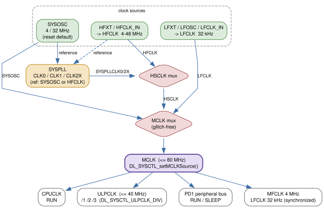
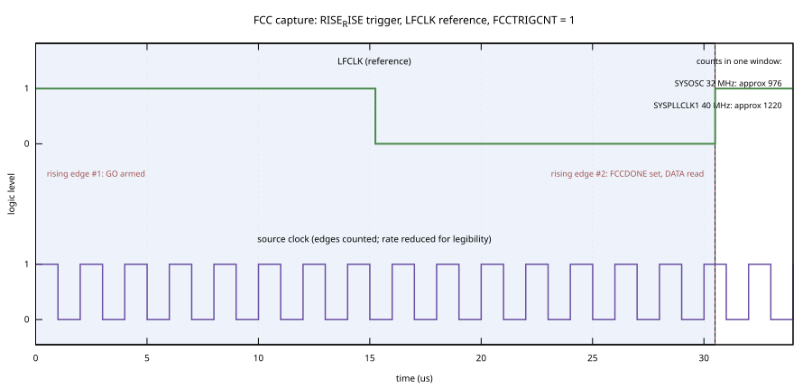
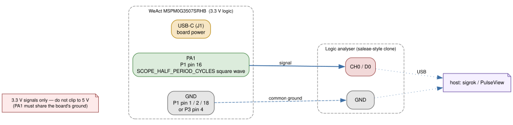

```{=latex}
\part{Core idioms}
```

# 5 — Clocks and SYSCTL

Chapter 4 gave you one shape for every peripheral: power, configure, enable,
use, disable. The blink you built worked because a delay helper counted CPU
cycles. Change the CPU clock and that blink changes with it — silently. Nothing
in the program tells you the clock moved. That is the problem this chapter
solves.

By the end you will be able to choose the clock that drives the whole chip,
route it through the SYSCTL clock tree, switch the running core onto it, and
then *measure* it rather than trust it. You will have built an 80 MHz system
from the reset default, by hand, with the Frequency Clock Counter as your proof
— and, if you have one, an inexpensive logic analyser as a second opinion.
Every timing number in the rest of this book — timer ticks, baud rates,
ADC sample periods, power figures — is derived from the decision you make here.

The organizing idea is four steps:

> **source → tree → switch → prove**

You pick a source. You see where it sits in the tree. You switch MCLK onto it.
You prove the result with the FCC. Everything below is those four steps.

## The shape of the clock system

MSPM0 does not have "a clock". It has a small tree rooted at **MCLK** (Main
Clock). MCLK is the synchronized root for the CPU clock, the high-speed
peripheral bus, and the low-power bus; it is also the reference the 4 MHz MFCLK
and 32 kHz LFCLK outputs are synchronized against (TRM *Section 2.3.2.1, MCLK
(Main Clock) Tree*).



Read it left to right as three layers:

- **Sources.** SYSOSC, the on-chip oscillator (4 MHz or 32 MHz); HFXT/HFCLK_IN,
  an external high-frequency clock (4–48 MHz, per the datasheet); LFXT/LFOSC/
  LFCLK_IN, the 32 kHz family. SYSOSC at 32 MHz is the reset default.
- **The high-speed mux.** SYSPLL and HFCLK feed an **HSCLK** mux. HSCLK is the
  "fast, accurate" input to MCLK.
- **The MCLK mux.** A glitch-free mux selects SYSOSC, HSCLK, or LFCLK as the
  actual MCLK source. MCLK then fans out to CPUCLK, ULPCLK, the PD1 bus, and
  the synchronized MFCLK/LFCLK outputs.

Two numbers constrain everything downstream. MCLK runs at up to **80 MHz**
(TRM 2.3.2.1). ULPCLK — the PD0 peripheral bus clock derived from MCLK through
the UDIV divider — must stay at or below **40 MHz** (TRM *Section 2.3.2.3,
ULPCLK (Low-Power Clock)*). If you raise MCLK to 80 MHz and forget ULPCLK, you
have violated the second number even though the first looks fine.

## Source

Start with the on-chip oscillator. Its frequency is a two-way choice between a
low setting and the base setting:

```c
/* ti/driverlib/m0p/sysctl/dl_sysctl_mspm0g1x0x_g3x0x.h */
__STATIC_INLINE void DL_SYSCTL_setSYSOSCFreq(DL_SYSCTL_SYSOSC_FREQ freq)
```

`freq` is `DL_SYSCTL_SYSOSC_FREQ_BASE` (32 MHz) or `DL_SYSCTL_SYSOSC_FREQ_4M`
(4 MHz). The header is explicit about a precondition: **MDIV must be disabled
before changing SYSOSC frequency** (see `DL_SYSCTL_setMCLKDivider`, below). On a
cold boot MDIV is already disabled, so the common case is a no-op — but if you
have divided MCLK down, undo that first. The call returns `void`.

The interesting source is the PLL. It is configured with a struct, not a
handful of arguments:

```c
void DL_SYSCTL_configSYSPLL(const DL_SYSCTL_SYSPLLConfig *config);
```

`config` points at a `DL_SYSCTL_SYSPLLConfig`. The fields that matter are the
reference (`sysPLLRef`, `SYSOSC` or `HFCLK`), the predivider (`pDiv`), the
feedback divider (`qDiv`), the three output dividers (`rDivClk2x`, `rDivClk1`,
`rDivClk0`) and their enables, the MCLK tap (`sysPLLMCLK`), and `inputFreq`.

`inputFreq` is the first real trap. It *looks* like a frequency, and its type
is `DL_SYSCTL_SYSPLL_INPUT_FREQ` with names like
`DL_SYSCTL_SYSPLL_INPUT_FREQ_16_32_MHZ`. In the implementation it is used as an
**address in flash**: the driver copies two tuning words from it into
`SYSPLLPARAM0/1` (see `dl_sysctl_mspm0g1x0x_g3x0x.c`, `DL_SYSCTL_configSYSPLL`).
Pass the enum constant, never a numeric frequency. It selects a band of PLL
lookup parameters, not a value you compute.

The PLL arithmetic is the TRM's (TRM *Section 2.3.1.3.1, Configuring SYSPLL
Output Frequencies*). With reference `fREF`:

```
fLOOPIN = fREF / PDIV
fVCO    = fLOOPIN * (QDIV + 1)
CLK1    = fVCO / (2 * (RDIVCLK1 + 1))
CLK2X   = 2 * fVCO / (RDIVCLK2X + 1)
```

Two preconditions from the header: the PLL must be **disabled** before
configuration, and **SYSOSC must be running at base frequency (32 MHz)** even
if you use HFCLK as the reference (`DL_SYSCTL_configSYSPLL` @pre). The
companion enable/disable calls exist:

```c
__STATIC_INLINE void DL_SYSCTL_enableSYSPLL(void)
__STATIC_INLINE void DL_SYSCTL_disableSYSPLL(void)
```

But here is the second trap: `DL_SYSCTL_configSYSPLL()` **already does all of
this for you.** It disables the PLL, waits for `SYSPLL_OFF`, writes the
dividers, loads the flash tuning words, calls `DL_SYSCTL_enableSYSPLL()`, and
busy-waits until `SYSPLLGOOD`. The header presents configure and enable as
separate calls; the implementation folds enable into configure. You do not call
`DL_SYSCTL_enableSYSPLL()` yourself after configuring. Calling it again is
harmless but redundant.

## Switch

Configuration and activation are separate, exactly as in Chapter 4. Having a
running PLL changes nothing until you point MCLK at it. That is a **macro**,
because the legal transitions depend on where you are coming from:

```c
#define DL_SYSCTL_setMCLKSource(current, next, ...) \
    DL_SYSCTL_switchMCLKfrom##current##to##next(__VA_ARGS__);
```

`DL_SYSCTL_setMCLKSource(SYSOSC, HSCLK, DL_SYSCTL_HSCLK_SOURCE_SYSPLL)` expands
to `DL_SYSCTL_switchMCLKfromSYSOSCtoHSCLK(DL_SYSCTL_HSCLK_SOURCE_SYSPLL)`:

```c
void DL_SYSCTL_switchMCLKfromSYSOSCtoHSCLK(DL_SYSCTL_HSCLK_SOURCE source);
```

The `source` argument picks whether HSCLK comes from `SYSPLL` or `HFCLK`. The
header notes that transitions between LFCLK and HSCLK must go through SYSOSC,
which is why the macro has a fixed vocabulary of `from`/`to` pairs rather than
one setter. The switch functions busy-wait until the move is confirmed.

Two supporting calls belong in the same breath:

```c
__STATIC_INLINE void DL_SYSCTL_setULPCLKDivider(DL_SYSCTL_ULPCLK_DIV divider)
__STATIC_INLINE void DL_SYSCTL_setMCLKDivider(DL_SYSCTL_MCLK_DIVIDER divider)
```

`DL_SYSCTL_setULPCLKDivider()` sets UDIV. At 80 MHz MCLK you need
`DL_SYSCTL_ULPCLK_DIV_2` to hold ULPCLK at 40 MHz (TRM 2.3.2.3). Note the
asymmetry: ULPCLK is *derived from MCLK*, so it is only divided when MCLK comes
from a high-speed source; when MCLK is SYSOSC or LFCLK, SYSCTL disables UDIV
automatically and ULPCLK equals MCLK.

`DL_SYSCTL_setMCLKDivider()` sets MDIV, the divider between SYSOSC and MCLK.
Its header comment gives the rules plainly: it should be
`DL_SYSCTL_MCLK_DIVIDER_DISABLE` when the source is HSCLK, is a don't-care for
LFCLK, and is a real divider only for SYSOSC. It is *not* the ULPCLK divider,
and it is not valid at all for an HSCLK source.

There is one more thing you must set before the switch, and it is easy to miss:

```c
__STATIC_INLINE void DL_SYSCTL_setFlashWaitState(
    DL_SYSCTL_FLASH_WAIT_STATE waitState)
```

Flash reads need more wait states as MCLK rises. The header notes that these
wait states are **only applied when MCLK runs from SYSPLL, HFXT, or HFCLK_IN**
— for SYSOSC and LFCLK, SYSCTL manages them automatically. So this call is
specifically the price of choosing a high-speed source.

Finally, you can read the tree back instead of assuming. Two functions do that:

```c
__STATIC_INLINE uint32_t DL_SYSCTL_getClockStatus(void)
__STATIC_INLINE DL_SYSCTL_MCLK_SOURCE DL_SYSCTL_getMCLKSource(void)
```

`DL_SYSCTL_getClockStatus()` returns a bitwise OR of the `DL_SYSCTL_CLK_STATUS_*`
flags — `..._SYSPLL_GOOD`, `..._HSCLK_GOOD`, `..._HFCLK_GOOD`, `..._LFOSC_GOOD`,
and so on. `DL_SYSCTL_getMCLKSource()` returns the active source as a
`DL_SYSCTL_MCLK_SOURCE`. These are the functions to poll when a switch seems not
to have taken, and the ones to read in a debugger when the program's timing
makes no sense.

## Prove

The Frequency Clock Counter (FCC) is a measurement instrument, not a feature
you enable and forget. It counts edges of a **source clock** over a window
defined by a **reference clock**, and hands you the count. The reference is
LFCLK (32 kHz, which after reset is the internal LFOSC — TRM *Section 2.3.2.6,
LFCLK (Low-Frequency Clock)*). The window is set by a trigger:

```c
void DL_SYSCTL_configFCC(DL_SYSCTL_FCC_TRIG_TYPE trigLvl,
    DL_SYSCTL_FCC_TRIG_SOURCE trigSrc, DL_SYSCTL_FCC_CLOCK_SOURCE clkSrc);
```

- `trigLvl` — `DL_SYSCTL_FCC_TRIG_TYPE_RISE_RISE` (count over a whole number of
  reference periods) or `DL_SYSCTL_FCC_TRIG_TYPE_LEVEL`.
- `trigSrc` — `DL_SYSCTL_FCC_TRIG_SOURCE_LFCLK` or `..._FCC_IN`.
- `clkSrc` — which clock to measure: `..._MCLK`, `..._SYSOSC`, `..._HFCLK`,
  `..._SYSPLLCLK0`, `..._SYSPLLCLK1`, `..._SYSPLLCLK2X`, and others.

With `RISE_RISE`, the number of reference periods is set separately:

```c
__STATIC_INLINE void DL_SYSCTL_setFCCPeriods(DL_SYSCTL_FCC_TRIG_CNT periods)
```

`periods` is one of `DL_SYSCTL_FCC_TRIG_CNT_01` … `_32`. One period is enough
for a coarse check; more periods trade measurement time for accuracy (TRM
*Section 2.3.5.1, Using the FCC*). Then you run a capture and read it:

```c
__STATIC_INLINE void DL_SYSCTL_startFCC(void)
__STATIC_INLINE bool DL_SYSCTL_isFCCDone(void)
__STATIC_INLINE uint32_t DL_SYSCTL_readFCC(void)
```

`DL_SYSCTL_startFCC()` arms the counter (it writes the GO bit and key).
`DL_SYSCTL_isFCCDone()` polls the `FCCDONE` flag, which hardware sets when the
window closes and clears when a new capture starts. `DL_SYSCTL_readFCC()`
returns the 22-bit count. A single call sequence is: configure, set periods,
start, wait for done, read.



Why the reference matters so little: if you measure **two** source clocks over
the *same* LFCLK window and take their ratio, the reference's own error cancels.
The TRM's worked example (TRM 2.3.5.1) uses this to calibrate SYSOSC against a
32.768 kHz crystal. The SDK's `sysctl_mclk_syspll` example uses the same trick
to confirm the PLL: it measures SYSPLLCLK1 and SYSOSC in turn, divides, and
compares the result to an expected ratio. That ratio, and the PLL settings that
produce it, are what the example below reproduces.

### A second opinion: a logic analyser on the pin

The FCC is an instrument *inside* the chip, so it is only as trustworthy as the
chip. For an independent check, put an external instrument on a pin. Any
inexpensive saleae-style logic analyser clone will do: the signal is about
1 kHz, so you are using almost none of the clone's bandwidth, and the free
sigrok / PulseView stack already speaks to most of these clones.

The example sets **PA1** — broken out on **P1 pin 16** — to a square wave whose
half period is a fixed number of CPU cycles:

```c
while (1) {
    delay_cycles(SCOPE_HALF_PERIOD_CYCLES);   /* 40000 cycles */
    DL_GPIO_togglePins(SCOPE_PORT, SCOPE_PIN);
}
```

Because `SCOPE_HALF_PERIOD_CYCLES` is a cycle count and not a wall-clock time,
the measured period is a direct read on MCLK: at 80 MHz, 40000 cycles is
0.5 ms, so the square wave runs at about 1 kHz.



Wire it the way you wired the DAP-Link in Chapter 1 — by function, not by
position:

| Board | Signal | Logic analyser |
| --- | --- | --- |
| P1 pin 16 (PA1) | square wave | CH0 / D0 |
| P1 pin 1, 2, or 18, or P3 pin 4 | GND | GND |

Keep the board powered from USB-C, and make sure the analyser and the board
share a ground; without it the trace is noise. Clip only to 3.3 V signals. The
DAP-Link can stay connected — this test does not use it.

Now capture with sigrok. In the PulseView GUI:

1. **Connect to Device**, pick your clone's driver (the classic 8-channel
   Cypress-FX2 clones appear as `fx2lafw`; `sigrok-cli --scan` prints the exact
   name for yours), and set the sample rate to 1 MHz.
2. Set the capture length to at least 100 ms — 100 000 samples at 1 MHz, or
   about 100 periods of the waveform.
3. Run. You should see a clean square wave on D0.
4. Drop two cursors on consecutive rising edges. The gap is the period; its
   reciprocal is the frequency. You are looking for about **1 kHz**.

If you prefer the command line, capture to a session file and inspect it:

```
sigrok-cli --scan
sigrok-cli -d fx2lafw -c samplerate=1m --samples=100000 -o pa1.sr
sigrok-cli -i pa1.sr -l 3
```

Then recover the core clock from the measured half period `t`:

```
MCLK  ≈  SCOPE_HALF_PERIOD_CYCLES / t
```

With `t = 0.5 ms` that is 40000 / 0.0005 = 80 MHz — the same answer the FCC
gave, from a completely different instrument.

Two honest limits. First, `delay_cycles()` guarantees *at least* the requested
cycles, and the loop's own overhead adds a few more, so the measured period is
slightly long and the inferred MCLK slightly high; the error shrinks as you
raise `SCOPE_HALF_PERIOD_CYCLES`. That is the Chapter 4 caveat, now visible on a
trace. Second, a clone's timebase is not a lab instrument's — its own accuracy
is a fraction of a percent at best — so treat the analyser reading as
corroboration of the FCC, not a replacement for it. The ratio method in the
exercises cancels most of both errors.

## Build it: an 80 MHz tree, measured

`examples/05-clock-tree/main.c` is the whole pipeline in one `main`. It carries
the manual GPIO init from Chapter 4 — plus one extra output pin, PA1, for the
logic-analyser test in *Prove* — and then runs the four steps:

```c
/* source: make the 32 MHz SYSOSC choice explicit */
DL_SYSCTL_setSYSOSCFreq(DL_SYSCTL_SYSOSC_FREQ_BASE);

/* wait states are only applied for SYSPLL/HFXT/HFCLK_IN sources */
DL_SYSCTL_setFlashWaitState(DL_SYSCTL_FLASH_WAIT_STATE_2);

/* configure the PLL (this call also enables it and waits for SYSPLLGOOD) */
DL_SYSCTL_configSYSPLL(&gSYSPLLConfig);

/* MCLK is 80 MHz; ULPCLK must stay at or below 40 MHz */
DL_SYSCTL_setULPCLKDivider(DL_SYSCTL_ULPCLK_DIV_2);

/* switch MCLK: SYSOSC -> HSCLK, where HSCLK is the SYSPLL */
DL_SYSCTL_setMCLKSource(SYSOSC, HSCLK, DL_SYSCTL_HSCLK_SOURCE_SYSPLL);
```

The config struct encodes the arithmetic from the Source section:

```c
static const DL_SYSCTL_SYSPLLConfig gSYSPLLConfig = {
    .inputFreq   = DL_SYSCTL_SYSPLL_INPUT_FREQ_16_32_MHZ,
    .rDivClk2x   = 3,                                  /* /4  */
    .rDivClk1    = 1,                                  /* /4  */
    .rDivClk0    = 0,
    .enableCLK2x = DL_SYSCTL_SYSPLL_CLK2X_ENABLE,
    .enableCLK1  = DL_SYSCTL_SYSPLL_CLK1_ENABLE,
    .enableCLK0  = DL_SYSCTL_SYSPLL_CLK0_DISABLE,
    .sysPLLMCLK  = DL_SYSCTL_SYSPLL_MCLK_CLK2X,
    .sysPLLRef   = DL_SYSCTL_SYSPLL_REF_SYSOSC,
    .qDiv        = 9,
    .pDiv        = DL_SYSCTL_SYSPLL_PDIV_2,
};
```

Work the numbers: `fLOOPIN = 32/2 = 16 MHz`, `fVCO = 16 * (9+1) = 160 MHz`,
`CLK1 = 160/4 = 40 MHz`, `CLK2X = 2*160/4 = 80 MHz`. Since `sysPLLMCLK` is
`CLK2X`, MCLK becomes 80 MHz.

Then it proves the result with the FCC, using the same method as the SDK
example:

```c
DL_SYSCTL_setFCCPeriods(DL_SYSCTL_FCC_TRIG_CNT_01);
g_fcc_pll_count    = measure(DL_SYSCTL_FCC_CLOCK_SOURCE_SYSPLLCLK1);
g_fcc_sysosc_count = measure(DL_SYSCTL_FCC_CLOCK_SOURCE_SYSOSC);
g_fcc_ratio = (g_fcc_pll_count * 1000U) / g_fcc_sysosc_count;
```

The measured ratio should be 40/32 = 1.25, i.e. 1250 once scaled by 1000. That
number and the ±0.3 % tolerance the SDK uses are taken straight from
`sysctl_mclk_syspll/ti_msp_dl_config.h`; this example loosens the tolerance to
±1 %. The LED lights when the ratio is in bounds; the raw counts and the ratio
sit in `g_fcc_*` for a debugger. When the check is done the program leaves the
FCC behind and drives PA1 as the ~1 kHz test square wave from *Prove*, so the
logic analyser always has something to measure — pass or fail.

### What this example deliberately skips

It does not touch **HFXT**. That source needs its two pins muxed as analog
oscillator pins, which is IOMUX work and belongs to the GPIO chapter; the SDK's
`sysctl_hfxt_run` example shows the shape but depends on that pinmux. The tree
diagram names HFXT so you know where it lives, not so you can configure it yet.
LFXT has the same story and gets its full treatment with the RTC chapter. It
also does not enable CLK_OUT (another pinmux), so you cannot scope the clock
itself out of the box. The FCC is your internal instrument; the PA1 square wave
in *Prove* is the external one.

## Common mistakes

**Expecting `DL_SYSCTL_enableSYSPLL()` to be needed after `configSYSPLL()`.**
It is not: configure already enables the PLL and waits for `SYSPLLGOOD`
(`dl_sysctl_mspm0g1x0x_g3x0x.c`). Read the header *and* the `.c`; here they
disagree about where enabling happens.

**Passing a frequency to `inputFreq`.** It is a flash address holding PLL
lookup parameters, not a number (`dl_sysctl_mspm0g1x0x_g3x0x.c`). Use the
`DL_SYSCTL_SYSPLL_INPUT_FREQ_*` enum.

**Configuring the PLL without SYSOSC at base frequency.** The header lists it
as a precondition even when the PLL reference is HFCLK.

**Forgetting ULPCLK.** MCLK may run at 80 MHz, but ULPCLK must be ≤ 40 MHz
(TRM 2.3.2.3). At 80 MHz MCLK, set `DL_SYSCTL_ULPCLK_DIV_2`.

**Confusing MDIV with UDIV.** `DL_SYSCTL_setMCLKDivider()` divides SYSOSC to
MCLK and is invalid for an HSCLK source; `DL_SYSCTL_setULPCLKDivider()` divides
MCLK to ULPCLK. They are different dividers in the same `MCLKCFG` register.

**Setting flash wait states when MCLK is SYSOSC or LFCLK and expecting an
effect.** The header says the value is only applied for SYSPLL/HFXT/HFCLK_IN
sources.

**Assuming the 32 kHz FCC reference is accurate.** It is not — after reset it is
the internal LFOSC. That is exactly why you measure a *ratio* against it rather
than an absolute frequency.

## Exercises

1. Before reading further, predict: after `DL_SYSCTL_configSYSPLL()` returns,
   is the PLL enabled? (Answer: yes — the implementation enables it and waits
   for `SYSPLLGOOD`.)
2. Change `.rDivClk2x` from 3 to 1 (`/2`). Recompute `CLK2X`, rebuild, and
   predict whether the FCC ratio changes. (The ratio is measured on **CLK1**,
   which is untouched, so it should not — a good check that you understand what
   the ratio is measuring.)
3. Set `.sysPLLMCLK = DL_SYSCTL_SYSPLL_MCLK_CLK0` and `.enableCLK0 =
   DL_SYSCTL_SYSPLL_CLK0_ENABLE`, keeping the other dividers. What MCLK
   frequency results, and what must happen to ULPCLK? (CLK0 divides by
   `2*(RDIVCLK0+1)`; with `rDivClk0 = 0` that is `/2` of `fVCO` = 80 MHz, so
   ULPCLK still needs `/2`.)
4. Delete the `DL_SYSCTL_setULPCLKDivider()` call, then add a read of
   `DL_SYSCTL_getClockStatus()` right after the switch. Which flags are set?
   Which rule from TRM 2.3.2.3 have you just broken?
5. Use `DL_SYSCTL_getMCLKSource()` after the switch and compare it to
   `DL_SYSCTL_MCLK_SOURCE_HSCLK`. What does it return if you comment out the
   `DL_SYSCTL_setMCLKSource()` line? Why?
6. Measure PA1 with the logic analyser as in *Prove*. Then comment out the
   `DL_SYSCTL_setMCLKSource()` line so MCLK stays on the 32 MHz SYSOSC, rebuild,
   and measure again. Divide the two periods: it should be 80/32 = 2.5. Taking
   the ratio cancels the `delay_cycles` overhead and most of the clone's
   timebase error — the same trick the FCC uses.

## Build the example

```
make -C examples/05-clock-tree
```

It produces `build/clock-tree.elf`, `build/clock-tree.bin`, and
`build/clock-tree.map`. `make -C examples/05-clock-tree clean` removes them.
See `examples/05-clock-tree/README.md` for the flash command and expected
behaviour.

## Further reading

- `sources/mspm0-sdk/source/ti/driverlib/m0p/dl_sysctl.h` — the umbrella that
  selects the device header below
- `sources/mspm0-sdk/source/ti/driverlib/m0p/sysctl/dl_sysctl_mspm0g1x0x_g3x0x.h`
  — every SYSCTL symbol in this chapter, the `DL_SYSCTL_SYSPLLConfig` struct,
  and the `DL_SYSCTL_FCC_*` / `DL_SYSCTL_CLK_STATUS_*` enums
- `sources/mspm0-sdk/source/ti/driverlib/m0p/sysctl/dl_sysctl_mspm0g1x0x_g3x0x.c`
  — `DL_SYSCTL_configSYSPLL` (flash lookup, internal enable, blocking wait)
- `sources/mspm0-sdk/examples/nortos/LP_MSPM0G3507/driverlib/sysctl_mclk_syspll/`
  — the PLL settings and FCC ratio check this example reproduces
- `sources/mspm0-sdk/examples/nortos/LP_MSPM0G3507/driverlib/sysctl_frequency_clock_counter/`
  — a fuller FCC pass/fail example
- `sources/mspm0-sdk/examples/nortos/LP_MSPM0G3507/driverlib/sysctl_hfxt_run/`
  — the HFXT source path (needs pinmux from the GPIO chapter)
- TRM `sources/trm/slau846c.txt`: Section 2.3.1.2 (SYSOSC), 2.3.1.3 and
  2.3.1.3.1 (SYSPLL and output frequencies), 2.3.2.1 (MCLK tree), 2.3.2.3
  (ULPCLK), 2.3.2.8 (HSCLK), 2.3.3 (Clock Tree), 2.3.5 / 2.3.5.1 / 2.3.5.2
  (FCC)
- Datasheet `sources/datasheet/mspm0g3507.txt` — HFXT 4–48 MHz range, LFXT
  32 kHz, and the pin functions named in the tree
- Host tools for the second instrument in *Prove* — sigrok / PulseView and
  `sigrok-cli` (like PyOCD, they are host software, not board or SDK sources):
  `sigrok-cli --scan` identifies your analyser's driver.
