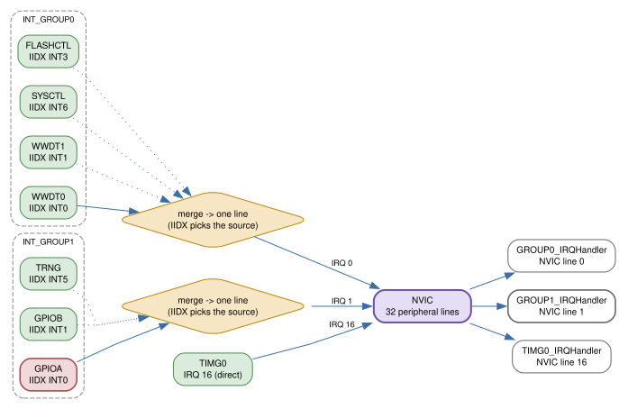
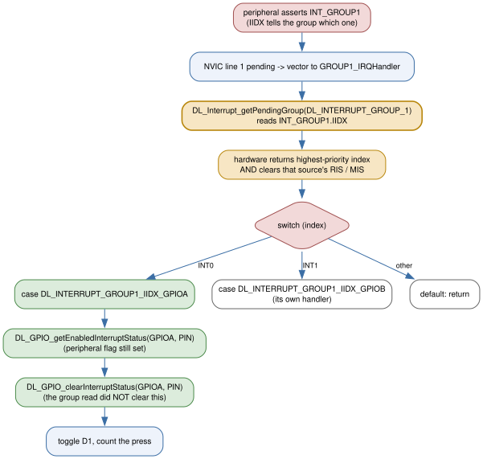

# 6 — Interrupts and the NVIC

Wire a pushbutton to PA12, turn on its interrupt, and write the function your
intuition reaches for — `GPIOA_IRQHandler` — and it will never be called. Not "called late", not "called with a stale flag": never. The linker
will quietly throw it away. That is not a quirk of this board or of DriverLib;
it is how the Cortex-M0+ vector table works once a device has more interrupt
sources than the CPU has vector slots.

By the end of this chapter you will know why that handler is dead, what to
write instead, and how to find out which of several peripherals sharing one
slot actually fired. You will have built a pushbutton example whose handler is
named after the **group**, not the peripheral, and you will have reproduced the
trap deliberately and watched the LED stop responding. Along the way you will
meet the two masks every interrupt needs, the four priority levels, and the
`SCB->VTOR` trick for moving the vector table into RAM.

The chapter has one idea, and everything else is that idea applied:

> **The vector table has one slot per NVIC interrupt line, not one per
> peripheral. Many peripherals share a line; the group's `IIDX` register is the
> switchboard that tells you which one fired.**

## 32 slots, more than 32 sources

Start with the number that causes the trouble. The Cortex-M0+ nested vectored
interrupt controller (NVIC) has **32** native peripheral interrupt inputs
(TRM *Section 3.3.1, Peripheral Interrupts (IRQs)*). The MSPM0G3507 has more
peripherals than that. So TI grouped the low-priority ones: several peripheral
interrupt lines are merged by an **interrupt group** (`INT_GROUP`) into a
single NVIC input, and the CPU sees only the group's line. The grouping is
described in TRM *Section 3.3.1.2, Interrupt Groups*.



The G3507 exposes two groups plus a set of ungrouped sources. The datasheet's
interrupt vector table (`sources/datasheet/mspm0g3507.txt`, Table 8-7,
*Interrupt Vector Number*) is the authoritative mapping, and the compiler's
`IRQn_Type` enum in
`sources/mspm0-sdk/source/ti/devices/msp/m0p/mspm0g350x.h` spells out the
collision. Read these lines:

```c
/* mspm0g350x.h:75-85 */
SYSCTL_INT_IRQn = 0,      /* 16 SYSCTL_INT Interrupt */
WWDT1_INT_IRQn  = 0,      /* 16 WWDT1_INT Interrupt */
WWDT0_INT_IRQn  = 0,      /* 16 WWDT0_INT Interrupt */
FLASHCTL_INT_IRQn = 0,    /* 16 FLASHCTL_INT Interrupt */
DEBUGSS_INT_IRQn  = 0,    /* 16 DEBUGSS_INT Interrupt */
GPIOB_INT_IRQn  = 1,      /* 17 GPIOB_INT Interrupt */
GPIOA_INT_IRQn  = 1,      /* 17 GPIOA_INT Interrupt */
...
```

Every `*_IRQn` on the left is a different peripheral, but they are not
different interrupts: `WWDT0`, `WWDT1`, `SYSCTL`, `FLASHCTL`, and `DEBUGSS` are
all **IRQ 0**, and `GPIOA` and `GPIOB` (with `TRNG` and the comparators) are
all **IRQ 1**. The enum gives each peripheral a friendly name, but those five
entries collapse to just one line, IRQ 0, and the GPIO entries to just IRQ 1.
The ungrouped peripherals keep their own lines (2–31).

That is why `NVIC_EnableIRQ(GPIOA_INT_IRQn)` is not "enable GPIOA" — it is
"enable NVIC line 1", the same line `GPIOB_INT_IRQn` names. And it is why the
startup file
(`sources/mspm0-sdk/source/ti/devices/msp/m0p/startup_system_files/gcc/startup_mspm0g350x_gcc.c`)
contains `GROUP0_IRQHandler` and `GROUP1_IRQHandler` but no `GPIOA_IRQHandler`:

```c
/* startup_mspm0g350x_gcc.c:68-69, 115-116 */
extern void GROUP0_IRQHandler (void) __attribute__((weak, alias("Default_Handler")));
extern void GROUP1_IRQHandler (void) __attribute__((weak, alias("Default_Handler")));
...
    GROUP0_IRQHandler,                     /* GROUP0 interrupt handler  */
    GROUP1_IRQHandler,                     /* GROUP1 interrupt handler  */
```

You met this mechanism in Chapter 2: each handler is a *weak* alias to a
do-nothing trap, so defining the same name yourself lets the linker prefer
yours. For a grouped source there is nothing else to define. A function named
`GPIOA_IRQHandler` matches no entry in `interruptVectors`, so under the
Makefile's `--gc-sections` it is discarded before the image is even built.
`GROUP1_IRQHandler` is the only handle you get.

## Two masks, and you must turn both

An interrupt reaches the CPU only if it is enabled in **two** independent
places, and they are configured by different code.

**At the peripheral**, the source has to be unmasked inside the peripheral's own
interrupt registers. For GPIO that is:

```c
/* ti/driverlib/dl_gpio.h */
__STATIC_INLINE void DL_GPIO_enableInterrupt(GPIO_Regs* gpio, uint32_t pins);
```

- `gpio` — the register-overlay pointer for the port (`GPIOA`, `GPIOB`, `GPIOC`).
- `pins` — a bitwise OR of `DL_GPIO_PIN_*`; here `DL_GPIO_PIN_12` (`dl_gpio.h:132`
  defines it as `0x00001000`).
- **Returns** `void`.
- **How it works:** it ORs `pins` into the port's `CPU_INT.IMASK` register
  (`dl_gpio.h:2580`). Only masked-in pins can drive the port's interrupt line.

There is a mirror, `DL_GPIO_disableInterrupt(GPIO_Regs* gpio, uint32_t pins)`
(`dl_gpio.h:2590`).

**At the NVIC**, the line has to be enabled, and that is a CMSIS call, not a
DriverLib one. The `dl_interrupt.h` header says so plainly in its own overview:
the module "is not for controlling the NVIC or the I-bit in the CPSR register"
— use the CMSIS-Core APIs from
`sources/mspm0-sdk/source/third_party/CMSIS/Core/Include/core_cm0plus.h`.

```c
/* core_cm0plus.h — public macro aliases (lines 695-703) onto __NVIC_* (lines 741+) */
__STATIC_INLINE void __NVIC_EnableIRQ(IRQn_Type IRQn);
__STATIC_INLINE void __NVIC_DisableIRQ(IRQn_Type IRQn);
```

- `IRQn` — a member of `IRQn_Type` (`mspm0g350x.h:68`), e.g. `GPIOA_INT_IRQn`.
  The functions no-op for negative values, so you may pass a system exception
  number harmlessly.
- **Returns** `void` (the getters return `uint32_t`: `1`/`0`).
- **How it works:** `EnableIRQ` sets the line's bit in `NVIC->ISER[0]`;
  `DisableIRQ` sets it in `NVIC->ICER[0]`. The NVIC maps line 0 to bit 0, line
  31 to bit 31 (TRM 3.3.1.1).

Why two? The TRM's note in 3.3.1.1 is direct about the failure mode: if a
peripheral asserts its line but the line is disabled *only* at the NVIC, the
interrupt goes pending but never runs, **and the wake-up controller keeps
holding an event for the processor**, so the part may stay in a higher power
mode than you intended. The SDK's `nvic_interrupt_disable` example makes the
same point in its source comment: mask at the peripheral, not just the NVIC.
For this chapter's example both masks are on; the difference matters once you
start putting the device to sleep (Chapter 21).

The enable *order* does not matter much, but clear any stale flag before you
enable. This is also where the group search starts in the field: if an
interrupt "doesn't fire", check the peripheral mask, then the NVIC bit, then
the priority, in that order.

## Priorities are four values, and a group cannot preempt itself

The NVIC lets you set a priority per line — but only four levels exist. The
device header defines the number of implemented priority bits:

```c
/* mspm0g350x.h:183 */
#define __NVIC_PRIO_BITS        0x0002U    /* Number of bits used for Priority Levels */
```

Two bits means four levels. `NVIC_SetPriority` takes the small number and
shifts it into the register for you:

```c
/* core_cm0plus.h */
__STATIC_INLINE void __NVIC_SetPriority(IRQn_Type IRQn, uint32_t priority);
__STATIC_INLINE uint32_t __NVIC_GetPriority(IRQn_Type IRQn);
```

- `priority` — the *logical* level, `0`–`3`. The implementation writes
  `priority << (8 - __NVIC_PRIO_BITS)`, so level `1` becomes `0x40` in the
  register. Lower value means **higher** priority (TRM 3.3.1.1); the raw
  levels in the register are `0`, `64`, `128`, `192`.
- **Returns** `void` for the setter; `uint32_t` (the un-shifted level) for the
  getter.
- **Caveat from the TRM:** do not change a line's priority while that interrupt
  is enabled or active — behavior is unpredictable. Set priorities before you
  enable.

Two rules follow that surprise people. First, if two pending interrupts share a
priority level, the one with the **lowest exception number** is taken first.
Second — and this is specific to grouping — the sources inside one group
**cannot preempt each other** (TRM 3.3.1.2, *Usage*). If `WWDT0` is being
serviced through `GROUP0` and `SYSCTL` asserts, `SYSCTL` waits: the two are one
NVIC line, and the CPU is already in that line's handler. It is serviced on the
next entry (tail-chained), not in the middle of the first.

## Dispatch: read the group, then the source

`GROUP1_IRQHandler` runs for any of GPIOA, GPIOB, TRNG, or the comparators.
Its first job is to ask the group which of them fired:

```c
/* ti/driverlib/m0p/dl_interrupt.h */
__STATIC_INLINE uint32_t DL_Interrupt_getPendingGroup(DL_INTERRUPT_GROUP group);
```

- `group` — `DL_INTERRUPT_GROUP_0` or `DL_INTERRUPT_GROUP_1` (`dl_interrupt.h:234`).
- **Returns** the highest-priority pending index in that group, as one of the
  `DL_INTERRUPT_GROUPn_IIDX_*` macros (`dl_interrupt.h:81-158`), or `0` if
  nothing is pending.
- **How it works:** it reads the group's `IIDX` register (`dl_interrupt.h:281`).
  The read is not passive: hardware returns the highest-priority source **and
  simultaneously clears that source's `RIS` and `MIS` bits** — that is the
  whole reason the register exists (TRM 3.3.1.2). So one call both identifies
  and acknowledges the group's pending source.



For this example, `DL_INTERRUPT_GROUP1_IIDX_GPIOA` (`dl_interrupt.h:118`) is the
value to match. Two related calls exist for when you want to see or clear more
than one bit at a time:

```c
/* ti/driverlib/m0p/dl_interrupt.h */
static inline uint32_t DL_Interrupt_getStatusGroup(
    DL_INTERRUPT_GROUP group, uint32_t interruptMask);
static inline void DL_Interrupt_clearGroup(
    DL_INTERRUPT_GROUP group, uint32_t interruptMask);
```

`interruptMask` is a bitwise OR of the `DL_INTERRUPT_GROUPn_*` macros
(`dl_interrupt.h:168-227`). `getStatusGroup` returns the masked pending bits;
`clearGroup` ORs them into the group's `ICLR`.

**Trap inside the trap.** The `IIDX` values and the `interruptMask` bits are
*not the same numbers*. `IIDX` is a 1-based index (`INT0` = 1, `INT1` = 2,
`INT2` = 3), while a mask is a bit position (`INT0` = 1, `INT1` = 2,
`INT2` = 4). They agree for the first two entries and diverge after that. The
header gives them separate macro families precisely so you never pass one where
the other is expected — but if you hand-roll a `1 << iidx` you will get this
wrong.

Once you know the source, the peripheral's own flag is still set. Reading the
group's `IIDX` clears the *group*, not GPIOA's flag, so you finish at the
peripheral:

```c
/* ti/driverlib/dl_gpio.h */
__STATIC_INLINE uint32_t DL_GPIO_getEnabledInterruptStatus(
    GPIO_Regs* gpio, uint32_t pins);
__STATIC_INLINE void DL_GPIO_clearInterruptStatus(GPIO_Regs* gpio, uint32_t pins);
```

- `pins` — a bitwise OR of `DL_GPIO_PIN_*` to select which pins to inspect or clear.
- `getEnabledInterruptStatus` **returns** `gpio->CPU_INT.MIS & pins`, i.e. only
  the pending flags that are also enabled; `clearInterruptStatus` **returns**
  `void` and ORs `pins` into `ICLR` (`dl_gpio.h:2631`, `:2699`).
- **Caveat:** if you clear a flag while the cause is still present (a held
  button, a level), hardware sets it again. Edge-triggered inputs like this one
  clear cleanly; level-triggered conditions do not, and you must resolve the
  condition first.

## Falling, rising, or both

A GPIO interrupt needs an **edge**. The feature is chosen with:

```c
/* ti/driverlib/dl_gpio.h */
__STATIC_INLINE void DL_GPIO_setLowerPinsPolarity(
    GPIO_Regs* gpio, uint32_t polarity);
__STATIC_INLINE void DL_GPIO_setUpperPinsPolarity(
    GPIO_Regs* gpio, uint32_t polarity);
```

- Splitting on pin number is deliberate: `setLowerPinsPolarity` covers DIO 0–15,
  `setUpperPinsPolarity` covers DIO 16–31, and each writes a different
  `POLARITY` register (`dl_gpio.h:2390`, `:2403`).
- `polarity` — a bitwise OR of `DL_GPIO_EDGE_POLARITY` values. These are named
  per pin: `DL_GPIO_PIN_12_EDGE_FALL`, `..._EDGE_RISE`, `..._EDGE_RISE_FALL`,
  `..._EDGE_DISABLE` (`dl_gpio.h:477-492`).
- **Returns** `void`.

For a momentary button pulling a pulled-up pin to ground, the useful edge is the
**falling** one — the press. Rising-edge (or both) is the right choice when the
electrical idle state is the opposite, and a floating switch wants an internal
pull so the idle level is defined:

```c
/* ti/driverlib/dl_gpio.h */
__STATIC_INLINE void DL_GPIO_initDigitalInputFeatures(uint32_t pincmIndex,
    DL_GPIO_INVERSION inversion, DL_GPIO_RESISTOR internalResistor,
    DL_GPIO_HYSTERESIS hysteresis, DL_GPIO_WAKEUP wakeup);
```

- `pincmIndex` — the IOMUX pin-control index, **not** a pin mask: PA12 is
  `IOMUX_PINCM34` (`mspm0g350x.h:804`). The same namespace split Chapter 4 warned
  about for outputs.
- `inversion` — `DL_GPIO_INVERSION_ENABLE`/`_DISABLE`.
- `internalResistor` — `DL_GPIO_RESISTOR_NONE`/`_PULL_UP`/`_PULL_DOWN`
  (`dl_gpio.h:1604`).
- `hysteresis` — `DL_GPIO_HYSTERESIS_ENABLE`/`_DISABLE`.
- `wakeup` — `DL_GPIO_WAKEUP_DISABLE`, or one of `..._ON_0`/`..._ON_1`/`..._ENABLE`
  to make the pin wake the device from STOP/STANDBY (`dl_gpio.h:1627`).
- **Returns** `void`. It assigns the whole `PINCM` register, so do it before any
  other per-pin configuration you expect to survive.

## Global masking, when you need atomicity

Sometimes you need to stop *all* interrupts for a few instructions — to check a
flag and act on it without a race. That is the CPU's `PRIMASK`, exposed as four
intrinsics from the CMSIS `cmsis_gcc.h`:

```c
/* core/Include/cmsis_gcc.h */
__STATIC_FORCEINLINE void __enable_irq(void);            /* line 196 */
__STATIC_FORCEINLINE void __disable_irq(void);           /* line 207 */
__STATIC_FORCEINLINE uint32_t __get_PRIMASK(void);       /* line 449 */
__STATIC_FORCEINLINE void __set_PRIMASK(uint32_t priMask); /* line 479 */
```

`__disable_irq()` sets PRIMASK (mask everything except NMI and HardFault);
`__enable_irq()` clears it. Because you often call these from code whose caller
already had interrupts off, save and restore rather than blanket-enable:

```c
uint32_t primask = __get_PRIMASK();
__disable_irq();
/* ... short critical section ... */
__set_PRIMASK(primask);   /* restore whatever it was, on or off */
```

This is a blunt instrument. It protects a few instructions, not a long
computation; for anything longer you are better off masking one peripheral and
leaving the rest of the system alive.

## Moving the vector table to RAM

The vector table normally lives in flash at address `0x00000000`; Chapter 2
showed it. `--gc-sections` cannot delete it because the linker script wraps it
in `KEEP`, and it contains weak aliases, so you replace handlers at build time
by defining their names. There is a second, run-time path:

```c
/* ti/driverlib/m0p/dl_interrupt.h */
void DL_Interrupt_registerInterrupt(uint32_t exceptionNumber, void (*intHandler)(void));
void DL_Interrupt_unregisterInterrupt(uint32_t exceptionNumber);
```

- `exceptionNumber` — the NVIC number, `0`–`31` (`IRQn_Type` values are already
  in this numbering).
- `intHandler` — the function to install; `unregister` puts `Default_Handler`
  back.
- **Returns** `void`.
- **How it works** (`dl_interrupt.c:49-68`): the first call copies all 48
  vectors out of `SCB->VTOR` (which at reset is `0x00000000`) into a RAM array
  in section `.vtable`, then points `SCB->VTOR` at that array. After that,
  changing a handler is a store. The linker script provides the home:

```
.vtable (_vtable_base_address) (NOLOAD) : ...   /* default 0x20200000 */
```

- **Caveat:** this only makes sense for the *runtime* case. If the handler is
  known at build time, put its name in the startup file's table and skip the
  RAM table entirely — the header says as much. The feature exists because
  Cortex-M0+ has no other way to swap a handler on the fly.

That is the `dl_interrupt.h` surface: the group dispatch calls, the two group
macro families, and the two relocation calls. Everything else about interrupts
on this device is either a peripheral-side call like the GPIO ones above, or a
CMSIS NVIC call.

## Build it: a button on GROUP1

`examples/06-nvic-grouping/main.c` wires it all together — no `ti_msp_dl_config.c`,
just the Chapter 4 lifecycle. The hardware is a momentary pushbutton between
**PA12** and **GND** (the internal pull-up holds the line high when open). PA12
is broken out on **P1 pin 5**. The front-matter BOM's pushbutton and two
jumpers are exactly what you need; the optional 10 kΩ resistor is unnecessary
because the pin uses its internal pull-up. This is the same pin the SDK's own
`gpio_simultaneous_interrupts` example uses for its first switch
(`GPIO_SWITCHES_USER_SWITCH_1`, `IOMUX_PINCM34`).

The initialization is the lifecycle with two pins:

```c
/* Stage 1 — power (GPIOA serves both pins) */
DL_GPIO_reset(LED_PORT);
DL_GPIO_enablePower(LED_PORT);
delay_cycles(POWER_STARTUP_DELAY);

/* Stage 2 — configure the LED output, and pick its idle level */
DL_GPIO_initDigitalOutput(LED_IOMUX);
DL_GPIO_clearPins(LED_PORT, LED_PIN);      /* active-low: clear == on */

/* Stage 3 — enable the LED output driver */
DL_GPIO_enableOutput(LED_PORT, LED_PIN);

/* Configure the button: internal pull-up, detect the press (falling edge) */
DL_GPIO_initDigitalInputFeatures(BUTTON_IOMUX, DL_GPIO_INVERSION_DISABLE,
    DL_GPIO_RESISTOR_PULL_UP, DL_GPIO_HYSTERESIS_ENABLE,
    DL_GPIO_WAKEUP_DISABLE);
DL_GPIO_setLowerPinsPolarity(BUTTON_PORT, DL_GPIO_PIN_12_EDGE_FALL);

/* Enable the interrupt at the peripheral, then at the NVIC. Both. */
DL_GPIO_clearInterruptStatus(BUTTON_PORT, BUTTON_PIN);
DL_GPIO_enableInterrupt(BUTTON_PORT, BUTTON_PIN);
NVIC_ClearPendingIRQ(GPIOA_INT_IRQn);
NVIC_SetPriority(GPIOA_INT_IRQn, 1);
NVIC_EnableIRQ(GPIOA_INT_IRQn);

while (1) {
    __WFI();
}
```

The handler is where the chapter's idea becomes code:

```c
void GROUP1_IRQHandler(void)
{
    switch (DL_Interrupt_getPendingGroup(DL_INTERRUPT_GROUP_1)) {
        case DL_INTERRUPT_GROUP1_IIDX_GPIOA:
            button_service();
            break;
        default:
            break;
    }
}
```

`button_service()` reads the pin's flag, clears it, toggles D1, and bumps
`g_button_presses`. The switch has a `default` for the same reason the group
does: other peripherals share IRQ 1, and a spurious or unhandled source should
fall through cleanly rather than be mistaken for the button.

The constants name the WeAct nets: `LED_PORT`/`LED_PIN`/`LED_IOMUX` are
`GPIOA`/`DL_GPIO_PIN_0`/`IOMUX_PINCM1` (PA0, D1, active-low) and
`BUTTON_PORT`/`BUTTON_PIN`/`BUTTON_IOMUX` are
`GPIOA`/`DL_GPIO_PIN_12`/`IOMUX_PINCM34` (PA12, P1 pin 5).

### The trap, made reproducible

Near the top of `main.c`:

```c
#define USE_PERIPHERAL_NAMED_HANDLER (0)
```

The shipped value is `0`, and the body lives in `GROUP1_IRQHandler`. Set it to
`1`, rebuild, flash, and press the button: nothing happens. The body has moved
into `GPIOA_IRQHandler`, no vector entry points at it, `--gc-sections` discards
it, and `GROUP1` is left as the weak `Default_Handler`, whose body is an
infinite loop. The CPU happily vectors into the group, lands in the trap loop,
and stays there. That is the entire failure the chapter opened with, on your
desk instead of in your head.

### What this example deliberately skips

It does not debounce. A mechanical button bounces for a few milliseconds, so one
press can toggle D1 several times. Fixing that is an exercise, and a proper fix
uses a timer — Chapter 10.

It does not use the button's wakeup feature (`DL_GPIO_WAKEUP_DISABLE` here) or
leave the NVIC disabled at the peripheral instead of the NVIC. Both are
deliberate: they belong with the low-power modes in Chapter 21, where the
"mask at the peripheral" rule from the TRM note actually costs you current.

It does not touch `TRNG`, the comparators, or `GPIOB`, which share IRQ 1. The
`default` case exists for them; the example never enables them.

## Common mistakes

**Writing `GPIOA_IRQHandler`.** The vector table has no such entry, so the
handler is dead code and the group falls back to `Default_Handler` (an infinite
loop). If an interrupt fires and your program appears to hang, look for this
first.

**Enabling only one of the two masks.** `NVIC_EnableIRQ` without
`DL_GPIO_enableInterrupt` leaves the peripheral silently masked; the peripheral
call without the NVIC call leaves the line pending forever. The TRM's note adds
a power cost to disabling only at the NVIC.

**Confusing the IIDX index with the interrupt mask.** `DL_INTERRUPT_GROUP1_IIDX_GPIOA`
is `1`, but that is an *index*, not a bit. `IIDX` `INT2` is `3`; the mask for
`INT2` is `4`. Use the header's two macro families and never `1 << iidx`.

**Forgetting to clear the peripheral flag.** Reading the group `IIDX` clears
the group, not GPIOA. If you skip `DL_GPIO_clearInterruptStatus`, the port's
flag stays set and the interrupt re-asserts immediately.

**Setting a priority while the interrupt is enabled or active.** The TRM says
this is unpredictable. Set priorities before `NVIC_EnableIRQ`.

**Expecting one grouped source to preempt another.** They share an NVIC line,
so they cannot (TRM 3.3.1.2). Sources you need to preempt must be ungrouped.

**Reading GPIOA and concluding which pin fired without turning both masks
on.** `DL_GPIO_getEnabledInterruptStatus` returns only *enabled* pending flags;
a pin whose interrupt you never enabled will not appear, which is correct but
easy to misread as "the button isn't working".

## Exercises

1. Before reading further, predict: with `USE_PERIPHERAL_NAMED_HANDLER` set to
   `1`, does the program compile? Where does the button interrupt go? (Answer:
   yes, it compiles; `--gc-sections` drops the dead handler and the group
   vectors to the weak `Default_Handler`, which loops forever.)
2. Rebuild with the trap switch on and use `arm-none-eabi-nm build/nvic-grouping.elf`.
   Which interrupt symbols survive? Then set it back to `0` and compare. What
   happened to `GPIOA_IRQHandler`?
3. Move the button to PA13 (`IOMUX_PINCM35`, P2 pin 5). What has to change in
   `main.c`? Which is the only symbol in the handler that must change, and why?
4. Change the polarity to `DL_GPIO_PIN_12_EDGE_RISE`. Rebuild and flash. Does D1
   toggle on press, on release, or not at all? Explain using the pull-up and
   the idle level.
5. Comment out `DL_GPIO_enableInterrupt()` but leave `NVIC_EnableIRQ()`. Does
   the LED respond? Now comment out `NVIC_EnableIRQ()` instead. Which failure is
   silent and which still leaves a pending line?
6. Set the priority to `NVIC_SetPriority(GPIOA_INT_IRQn, 3)` while it is
   enabled and running, then read it back with `NVIC_GetPriority()`. Does the
   read match what you wrote? (The TRM warns against doing exactly this; observe
   the result without relying on it.)
7. Debounce. A press toggles D1 several times because of contact bounce. Add a
   free-running counter in `SysTick_Handler` or a timer (Chapter 10) and ignore
   presses within a few milliseconds of the last one. This is the "you try it"
   that turns the example into something you would actually ship.

## Build the example

```
make -C examples/06-nvic-grouping
```

It produces `build/nvic-grouping.elf`, `build/nvic-grouping.bin`, and
`build/nvic-grouping.map`. `make -C examples/06-nvic-grouping clean` removes
them. See `examples/06-nvic-grouping/README.md` for the wiring, the flash
command, and the trap switch.

Then reproduce the trap: set `USE_PERIPHERAL_NAMED_HANDLER` to `1`, rebuild,
flash, and watch the LED go quiet. The only difference between the working and
the dead program is the handler's name.

## Further reading

- `sources/mspm0-sdk/source/ti/driverlib/m0p/dl_interrupt.h` — `DL_Interrupt_getPendingGroup`
  (line 279), `getStatusGroup` (264), `clearGroup` (296),
  `registerInterrupt` (327), `unregisterInterrupt` (346), the `DL_INTERRUPT_GROUP`
  enum (234), and the `DL_INTERRUPT_GROUPn_IIDX_*` / `DL_INTERRUPT_GROUPn_*`
  macros (81-227).
- `sources/mspm0-sdk/source/ti/driverlib/m0p/dl_interrupt.c` — the RAM vector
  copy and `SCB->VTOR` switch (49-68).
- `sources/mspm0-sdk/source/ti/driverlib/dl_gpio.h` — `DL_GPIO_enableInterrupt`
  (2578), `disableInterrupt` (2590), `getEnabledInterruptStatus` (2628),
  `clearInterruptStatus` (2696), `setLowerPinsPolarity` (2387),
  `setUpperPinsPolarity` (2400), `initDigitalInputFeatures` (2007),
  `DL_GPIO_PIN_*` (72-...), `DL_GPIO_EDGE_POLARITY` (231-...), `DL_GPIO_RESISTOR`
  (1604), `DL_GPIO_WAKEUP` (1627).
- `sources/mspm0-sdk/source/third_party/CMSIS/Core/Include/core_cm0plus.h` —
  `NVIC_EnableIRQ`/`DisableIRQ`/`SetPriority`/`GetPriority`/`GetEnableIRQ`/
  `SetPendingIRQ`/`ClearPendingIRQ`/`GetPendingIRQ` (741-885) and the
  `SCB->VTOR` field (359-360).
- `sources/mspm0-sdk/source/third_party/CMSIS/Core/Include/cmsis_gcc.h` —
  `__enable_irq` (196), `__disable_irq` (207), `__get_PRIMASK` (449),
  `__set_PRIMASK` (479), `__WFI` (909).
- `sources/mspm0-sdk/source/ti/devices/msp/m0p/mspm0g350x.h` — the `IRQn_Type`
  enum (68-108), `__VTOR_PRESENT` (182), `__NVIC_PRIO_BITS` (183), and
  `IOMUX_PINCM1`/`IOMUX_PINCM34` (PA0/PA12).
- `sources/mspm0-sdk/source/ti/devices/msp/m0p/startup_system_files/gcc/startup_mspm0g350x_gcc.c`
  — `GROUP0_IRQHandler`/`GROUP1_IRQHandler` declarations (68-69) and vector
  table entries (115-116); `Default_Handler`'s infinite loop (215).
- `sources/mspm0-sdk/examples/nortos/LP_MSPM0G3507/driverlib/nvic_interrupt_grouping/`
  — the grouped-interrupt seed, and `.../nvic_interrupt_disable/` — the
  peripheral-mask-vs-NVIC lesson.
- `sources/mspm0-sdk/examples/nortos/LP_MSPM0G3507/driverlib/gpio_simultaneous_interrupts/`
  — the SDK's `GROUP1_IRQHandler` for GPIO switches on `IOMUX_PINCM34`.
- TRM `sources/trm/slau846c.txt`: Section 3.3 (Interrupts and Exceptions),
  3.3.1 (Peripheral Interrupts), 3.3.1.1 (NVIC: enable, pending, priority, and
  the wake-up-controller note), 3.3.1.2 (Interrupt Groups and IIDX), 3.3.1.3
  (Wake Up Controller), 3.3.2 (Interrupt and Exception Table).
- Datasheet `sources/datasheet/mspm0g3507.txt` — Table 8-7, *Interrupt Vector
  Number* (`IRQ` and `GROUP IIDX` per peripheral).
- `examples/06-nvic-grouping/` — `main.c`, the Makefile, and the README.
